> I am a part of all that I have met.
>
> — Alfred, Lord Tennyson, *Ulysses*[^1]

## The dilemma facing AI-native organizations

A familiar scene in the AI era: an agent has made it halfway through a difficult duplicate-submission bug. It has changed the code, run tests, and ruled out two unsuitable approaches. The next day, the remaining work moves to a colleague or another agent, and everything starts again with “First, tell me about the project.”

The code is in the repository, and the logs are still there. But the most important details remain in yesterday's session: why this approach was chosen, which constraints must be respected, and which step is still only a hypothesis. The next person can see the result but cannot see how it was reached. Much work does not fail; it simply breaks at the handoff.

[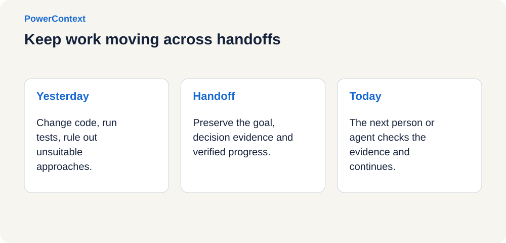](../../../assets/blog/powercontext-1-0-0-release/figure-01.en.svg "View full-size diagram")

This article is about that break: when work moves across sessions, tools, and participants, how can the next person use the thinking and verification that have already been completed?

PowerContext is working to make this a separate layer of working context. It keeps the current goal, the basis for decisions, verified progress, and the next step alongside the work, so a new person or agent does not have to reconstruct the story from an entire conversation history.

## An emerging consensus: the bottleneck is shifting from execution to collaboration

Several practices made public in 2026 have offered different answers, but they expose a shared problem: agents are taking on longer tasks, and a single piece of work is crossing more sessions, tools, and participants.

As tasks get longer, the runtime needs to remember what happened in the previous step.

[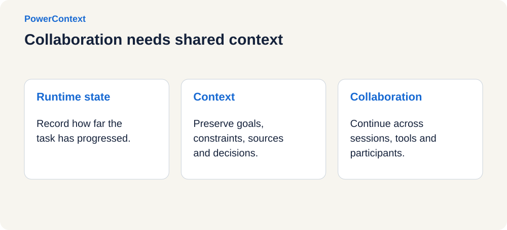](../../../assets/blog/powercontext-1-0-0-release/figure-02.en.svg "View full-size diagram")

**In January, organizational background became part of an agent's capabilities.[^2]** OpenAI's internal data agent brings together table schemas, human annotations, code, organizational knowledge, memory, and runtime state. A model may know how to write SQL, but it also needs to know how the company defines a metric and which data can be used together.

**In February, state began to span more than a single request.** AWS and OpenAI announced a stateful runtime environment for agents,[^3] allowing the runtime to support production tasks that span steps, tools, approvals, and system state.

**In March, progress records across sessions became essential for long-running tasks.** In its long-running research work,[^4] Anthropic maintained progress files recording the current state, verification results, and unsuccessful approaches, so later sessions would not retry paths that had already failed.

**In April, human context switching became a bottleneck.** Coordination costs rise as more participants join. In its work on Symphony,[^5] OpenAI observed that engineers could usually manage three to five sessions comfortably. This was one team's observation, not a fixed limit for everyone.

**In May and June, context began to be managed independently.** LangChain released Context Hub[^6] for storing, versioning, collaborating on, and publishing context files. Google Cloud's production-agent guides[^7] included checkpoints, recovery, and human approval in the execution mechanisms for long-running tasks. At Build 2026,[^8] Microsoft also introduced context capabilities connecting people, email, documents, meetings, and business data.

In July and August, multi-agent collaboration experiments published by Anthropic[^9] had already observed code merge conflicts, isolated ways of working, and collective errors caused by multiple agents converging on the same decisions.

These practices address runtime state, context content, and collaboration among participants, but point to a common problem: execution is getting cheaper, while the cost of coordination and verification is becoming more visible. Taken together, they suggest that a chat window can no longer carry the complete history of a long-running piece of work on its own.

Opening more agents can increase execution capacity. But which task a result belongs to, which version of the code it was based on, and whether the next participant can use it directly still require explicit records and checks.

[](../../../assets/blog/powercontext-1-0-0-release/figure-03.en.svg "View full-size diagram")

## The way forward: collaboration starts by letting work leave the session

Complex tasks often cross several boundaries: conversation windows fill up, models change, engineers finish their shifts, and work moves from development to testing, presales, or on-call support. Each time a boundary is crossed, the recipient needs to establish a few things:

- What needs to be completed now?
- Which results have been verified, and where is the evidence?
- Which approaches were tried and abandoned, and why?
- Which questions remain unanswered, and what should the recipient do first?

Conversation history, Memory, and Handoff all concern context, but each has a different responsibility.

[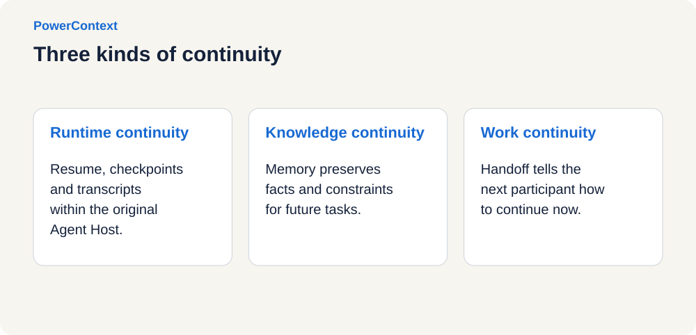](../../../assets/blog/powercontext-1-0-0-release/figure-04.en.svg "View full-size diagram")

**Runtime continuity** concerns how the same session keeps running. `resume`, checkpoints, or transcripts can help the same Agent Host recover its previous state. That state usually still depends on the original tool and session format.

**Knowledge continuity** preserves facts, constraints, and decisions that will matter in future tasks. Memory and RAG can retrieve information such as “the target environment has no Redis” or “historical compensation is out of scope for this phase,” but do not necessarily explain how far the current work has progressed.

**Work continuity** tells the next participant how to proceed now. Handoff organizes the current goal, verified progress, blockers, next steps, and evidence. The recipient may be a new session, a new model, another Agent Host, or a person.

Runtime state stays with the Agent Host. Judgments that remain useful across tasks go into Memory. Work in progress moves to the next participant through Handoff. Storing everything together only makes the record longer.

> Memory answers, “What should we still remember in the future?”
>
> Handoff answers, “How does the next participant continue right now?”

MCP connects tools and data, A2A lets agents discover and call other agents, and checkpoints restore a run. When unfinished work leaves its original session, it also needs handoff state independent of any single Agent Host.

## Beyond the consensus: three choices behind PowerContext

After PowerMem addressed long-term memory, we encountered a more specific question: how do you hand unfinished work to the next participant? That question led to PowerContext.

PowerContext is a context runtime layer for collaboration between people and agents. It references materials relevant to the current work from knowledge bases, tickets, code repositories, and observability systems, then organizes goals, evidence, decisions, progress, and next steps into project context that can be used to continue the work.

> **Memory keeps facts from being forgotten; Handoff keeps work from starting over.**

[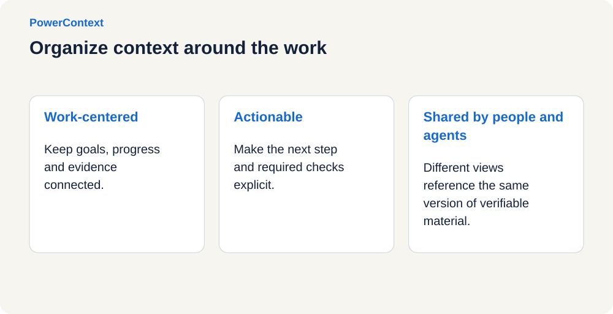](../../../assets/blog/powercontext-1-0-0-release/figure-05.en.svg "View full-size diagram")

PowerContext builds three constraints into its product design. Context is organized around work in progress, preserving relationships between pieces of information. A handoff is judged by whether the recipient can act on it, rather than by how much of the full log can be put back into the window.

The recipient can be an agent or a person. Anthropic's work on trustworthy agents similarly emphasizes human control, transparency, and returning decisions to people at the appropriate time. See *Trustworthy agents in practice*.[^10]

The design that follows centers on three questions: can the work be handed over successfully, can the handoff content be trusted, and can it follow the project into another agent environment?

## PowerContext's answer: work that can be resumed, trusted, and carried across tools

### Make work resumable: let Handoff carry unfinished work

Handoff serves a piece of work that has not yet ended. It should tell the recipient how to act and where to stop and confirm things first. The combined scenario at the beginning can be organized into the following work package:

| Item | Content |
| --- | --- |
| Goal | Fix duplicate submissions before the next canary-release window |
| Scope | Handle duplicate writes in this change; assess historical compensation separately |
| Verified | Replaying the same request identifier reliably reproduces the problem |
| Abandoned | A distributed-lock approach significantly increases latency in the reconciliation path |
| Environment constraints | The target environment has no cache cluster; the approach must work with the existing database environment |
| To verify | The impact of database changes on production and compatibility with older clients |
| Next step | Complete the database risk review and compatibility checks, then let a person decide whether to proceed with the canary release |
| Evidence | Reproduction logs, environment notes, the corresponding code version, and test conditions |

“To verify” needs to be as visible as “verified.” If only good news is retained, the recipient can easily treat unverified parts as conclusions too. This work package provides both the next step and the evidence still needed before proceeding.

[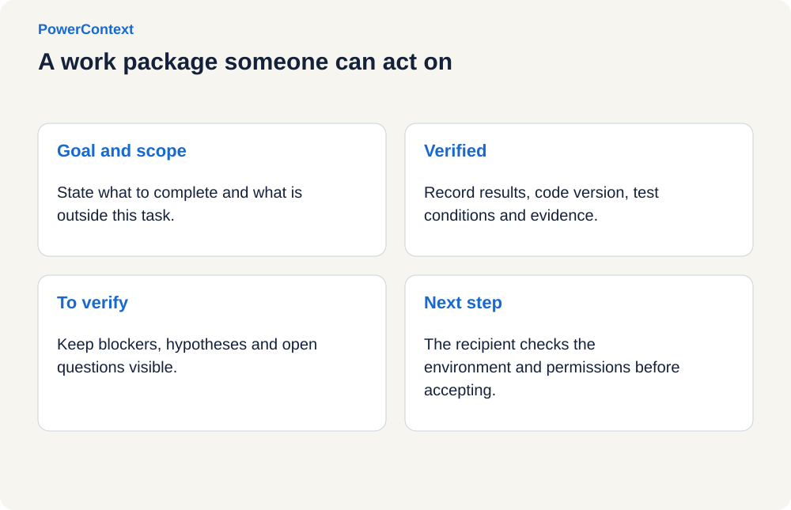](../../../assets/blog/powercontext-1-0-0-release/figure-06.en.svg "View full-size diagram")

When delegating, first define the goal and completion boundary. A person or agent then organizes progress, blockers, next steps, and their evidence. When a milestone needs to be preserved, commit the work package as a traceable version. When the task finishes, becomes blocked, or is interrupted, record the outcome and verification evidence.

The recipient compares it with the current repository, current instructions, their capabilities, and their permissions, then chooses whether to accept, request clarification, or decline the handoff.

Sending a handoff, accepting it, and completing the task are recorded separately, so the team can see where the work has stopped. Accepting a handoff does not itself expand permissions; publishing still has to meet the current authorization requirements.

By default, a handoff serves the current task and does not automatically become long-term Memory. The reason an approach was rejected first stays with the current investigation; environment constraints that remain valid over time can be written separately to Memory. People and agents can read different views of the same version: a person starts with business impact, trade-offs, and pending decisions, while an agent expands execution details and checks. Both still reference the same set of verifiable materials.

### Make context trustworthy: preserve sources and boundaries

When a model receives more history, outdated judgments, incorrect summaries, malicious content, and irrelevant noise can enter the window with it. A guess in a group chat, an environment description, and a test log do not have the same evidentiary status. A test result applies only to a particular code version and set of conditions; an environment constraint cannot immediately become a rule for the whole product.

[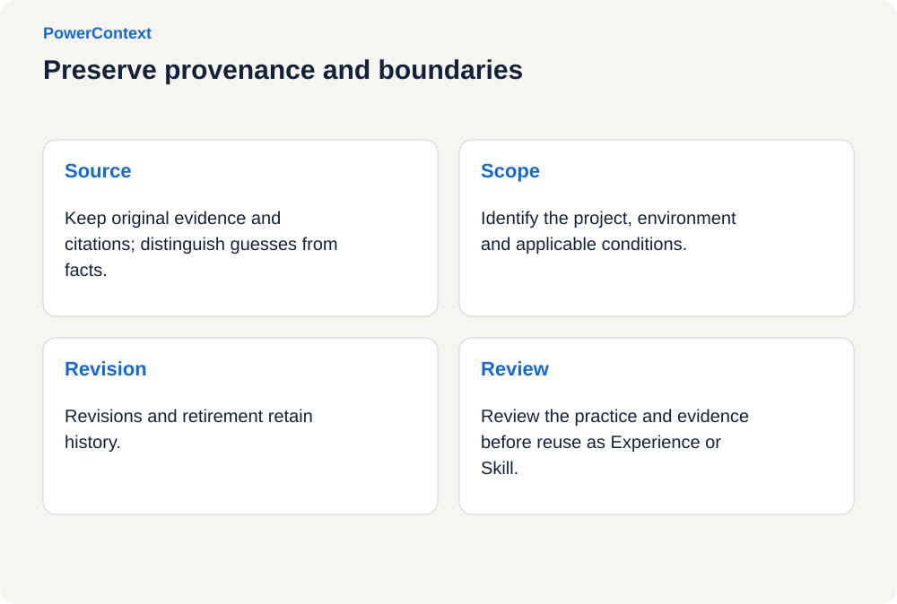](../../../assets/blog/powercontext-1-0-0-release/figure-07.en.svg "View full-size diagram")

Source records provenance and evidence boundaries. Capturing a prompt does not send every sentence in it directly into long-term Memory. Selected content enters Memory / Artifact; revisions and retirement retain history, and every change can be traced to its source.

The Server generates PreparedContext according to the current Scope, relevance, and byte budget. The default request-budget ceiling is 8,000 UTF-8 bytes. When recall fails, a fallback policy allows the original work to continue. An agent or caller can submit Experience and Skill candidates, which become immutable assets after Review.

In enterprise projects, scope changes, interface constraints, historical commitments, and unresolved issues are often scattered across CRM systems, tickets, email, and meeting notes. A retrieval hit only indicates possible relevance. `Scope`, `revision`, and `citation` must also explain which project it belongs to, which decision it came from, and what supports it.

One success does not immediately become a team rule. A command that works in one repository could cause damage in a different environment. The approach and its evidence need to enter Review before deciding whether to preserve it as an Experience or Skill.

### Make context portable: agents can change without restarting project context

Teams often use different models, frameworks, IDEs, and agents at the same time. Debugging may happen in Codex today and review in Claude Code tomorrow. One team may build business agents with LangChain while another orchestrates workflows with LangGraph.

PowerContext makes the Server an independent runtime layer:

- Local development can use OceanBase seekdb directly for underlying storage, while team deployments can choose an OceanBase cluster.
- Unified capabilities are exposed through HTTP/OpenAPI and Streamable HTTP MCP.
- The Runtime maintains project Scope, history-preserving `revision`, `citation`, Handoff, and Review contracts.
- Agent integrations collect, recall, and present context at the appropriate times, sharing the same context contracts.

[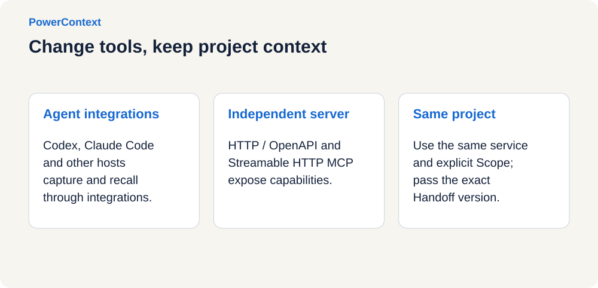](../../../assets/blog/powercontext-1-0-0-release/figure-08.en.svg "View full-size diagram")

The project currently provides 12 integrations: Codex, Claude Code, DeepSeek Harness, Hermes Agent, Pi Coding Agent, OpenClaw, OpenCode, WorkBuddy, Bub, Pydantic AI, LangChain, and LangGraph. Participants can continue from the current state after connecting to the same service, selecting the same project Scope, and receiving a specific version of the Handoff.

## How a piece of work moves through PowerContext

PowerContext's main path can be described in five steps. It does not move all information into a new system; it connects evidence and work state above existing systems.

[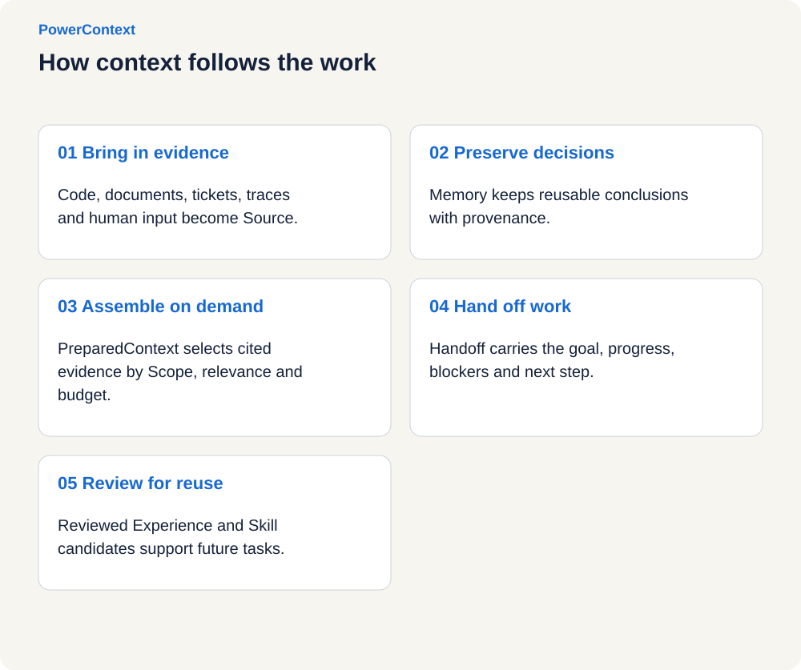](../../../assets/blog/powercontext-1-0-0-release/figure-09.en.svg "View full-size diagram")

- **Step one: bring in the evidence.** Code, documents, tickets, traces, agent trajectories, and human input can all become Source. PowerContext focuses on source references and evidence relationships, rather than replacing users' existing data systems.
- **Step two: preserve judgments worth reusing.** Decisions, constraints, outcomes, and state can be recorded explicitly. With a generation model configured, candidate information can also be extracted from Source. Every Memory retains its provenance, and later revision or retirement does not erase history.
- **Step three: assemble bounded context when needed.** Before an agent receives a request, the Runtime generates `PreparedContext` according to project Scope, relevance, and budget, with `citation` attached. The goal is not “everything that might be relevant” but “the minimum sufficient context for the next step.” This aligns with Anthropic's just-in-time context and progressive-disclosure approach: keep lightweight references and expand them at runtime as needed, rather than filling the window in advance.
- **Step four: form a Handoff before participants change.** The goal, verified progress, blockers, next steps, and evidence are organized into a work package for a new session, task, model, Agent Host, or the next person.
- **Step five: let reuse produce feedback without bypassing governance.** Practices verified across multiple tasks enter the Experience / Skill Candidate and Review process. Approved assets then serve future work, creating a reuse loop controlled by people.

These five steps form a traceable chain of work. Whether they actually reduce restarting and improve task outcomes still has to be answered through evaluation.

## Does it improve results? Let public evaluations answer

A context product can easily try to demonstrate its value with a clever demo or a few retrieval results. PowerContext looks at two things together: accuracy and cost in long-term memory question answering, and task completion rates for coding agents.

### LoCoMo: retrieve the right history quickly, and provide just enough

LoCoMo is a public dataset for long-conversation memory. PowerContext's end-to-end evaluation includes 10 conversations, 272 sessions, 5,882 turns, and 1,986 questions. The 1,540 questions in categories 1–4 are included in scoring.

[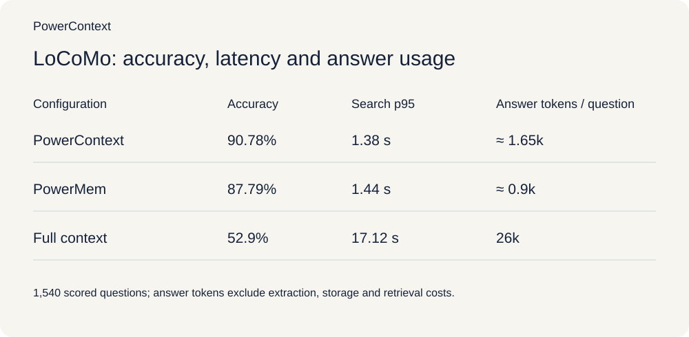](../../../assets/blog/powercontext-1-0-0-release/figure-10.en.svg "View full-size diagram")

Compared with the full-context baseline, PowerContext's accuracy is 37.88 percentage points higher, search p95 is approximately 91.9% lower, and answer tokens per question are approximately 93.7% lower. Compared with PowerMem, accuracy is 2.99 percentage points higher, search p95 is slightly lower, and answer-token usage is higher.

[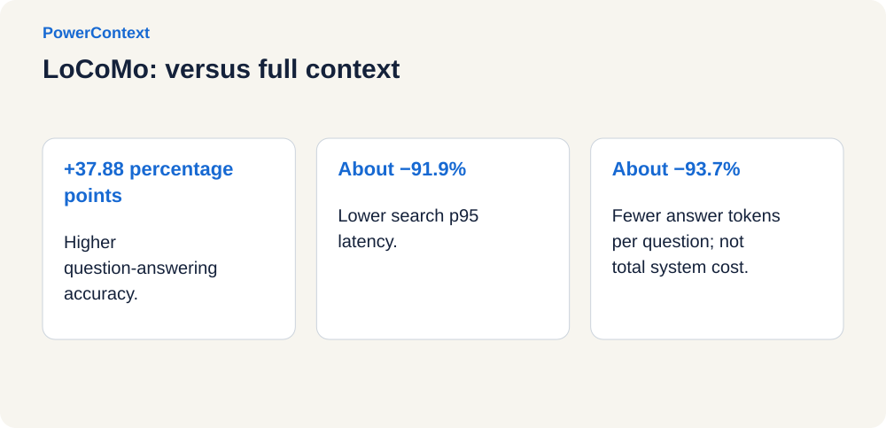](../../../assets/blog/powercontext-1-0-0-release/figure-11.en.svg "View full-size diagram")

### SWE-bench Pro public v2: context ultimately needs to improve task outcomes

Memory question answering measures whether information can be retrieved. Coding-agent evaluation is closer to whether a task can be completed. PowerContext ran an OFF / ON comparison in Codex across the 731 tasks in SWE-bench Pro public v2. Both groups used `gpt-5.6-sol` with `medium` reasoning effort:

[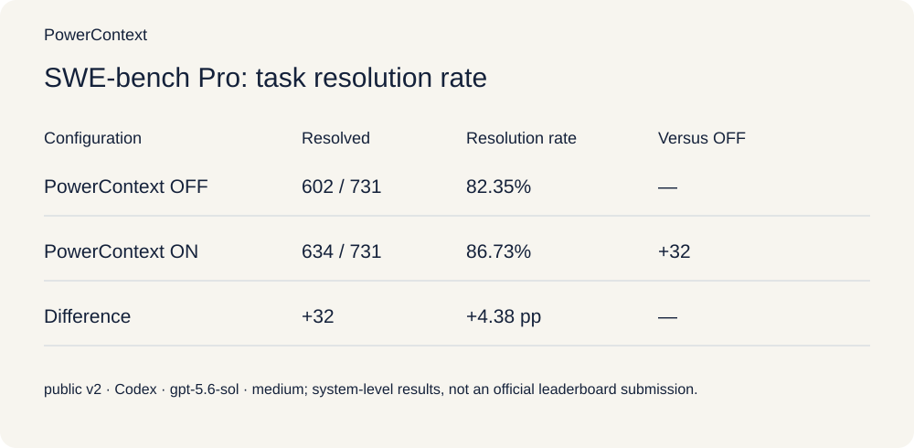](../../../assets/blog/powercontext-1-0-0-release/figure-12.en.svg "View full-size diagram")

| Configuration | Tasks completed | Task resolution rate |
| --- | --- | --- |
| PowerContext OFF | 602 / 731 | **82.35%** |
| PowerContext ON | 634 / 731 | **86.73%** |
| Difference | **+32** | **+4.38 percentage points** |

[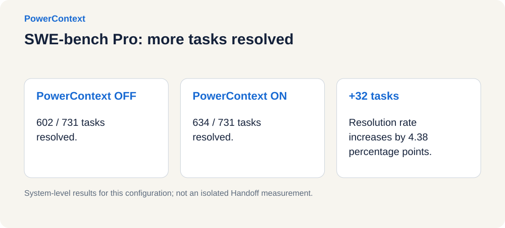](../../../assets/blog/powercontext-1-0-0-release/figure-13.en.svg "View full-size diagram")

For this task set and configuration, the results provide an encouraging signal: **PowerContext's effect can be tested through completion rates on real agent tasks.**

## Try it: start a real task in three minutes

The following example uses a local Codex CLI on macOS or Linux with PowerContext 1.0.0. Prepare Python 3.11+, Git, `uv`, and an installed Codex CLI.

Install and start the service:

```bash
uv tool install "powercontext[cli,server]==1.0.0"
powercontext server run
```

Without custom configuration, the Server listens on `127.0.0.1:8000` and uses local persistent SQLite storage. Leave this terminal running.

Open another terminal, enter the project you want to try, install the matching integration version, and run the checks:

```bash
powercontext setup codex --ref powercontext-v1.0.0
powercontext doctor
powercontext doctor codex
codex
```

Confirm that the new session has loaded the PowerContext Hook and MCP, and check the Server address, authentication configuration, and Scope. When multiple projects need isolation, configure Scope explicitly rather than relying on changing directories. See the Agent integration guide[^11] for the complete steps. Then run three checks:

[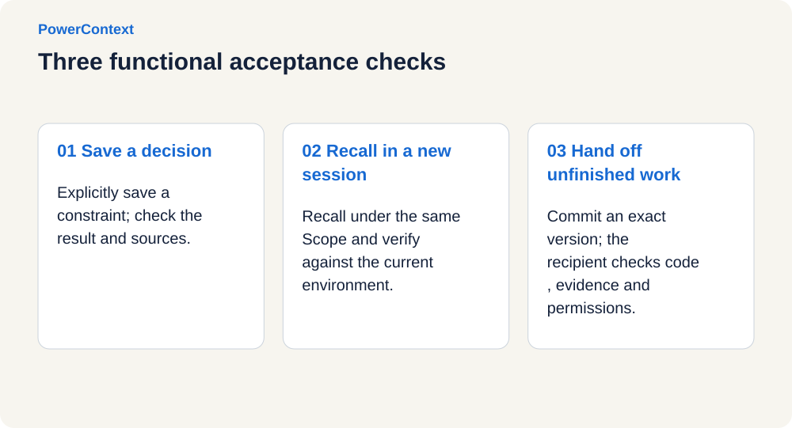](../../../assets/blog/powercontext-1-0-0-release/figure-14.en.svg "View full-size diagram")

1. **Save a constraint.** Explicitly ask to save a project judgment that will remain useful to PowerContext, and check the save result and source references.
2. **Retrieve it in another session.** In a new session with the same Scope, ask about that judgment and check that its contents are correct and its references can be verified. Repeating it successfully does not mean the conclusion is still valid; compare it with the current environment.
3. **Hand off unfinished work.** Ask to use PowerContext to hand off the current work, check its actual state, commit the Handoff, and provide the exact version. Give that version to the recipient and have them check the code, evidence, and permissions before confirming whether to accept it.

Passing `doctor` only means that the corresponding diagnostic checks passed. It does not replace these three functional acceptance checks.

Explicit Memory operations and manually preparing and committing Handoff do not require configuring a PowerContext Server generation model in advance. Automatic memory extraction, vector search, and similar capabilities need the corresponding generation and embedding configuration. An agent's subscription login does not automatically supply model APIs to the Server.

> Note:
>
> Local mode uses a database to store context by default and provides a dashboard. For handoffs across tools, connect both participants to the same service and explicitly select the same project Scope. Connecting to the same service does not mean that the same project context has already been selected.

## Committed to open source: context infrastructure must be inspectable, extensible, and portable

Project context informs an agent's decisions and carries a team's work history. What was stored, why it was recalled, who changed it, and how it can be migrated should all be inspectable.

[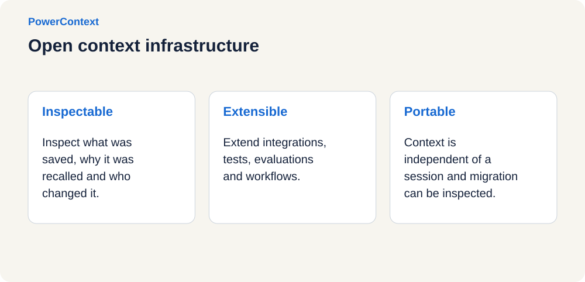](../../../assets/blog/powercontext-1-0-0-release/figure-15.en.svg "View full-size diagram")

PowerContext is open source under Apache License 2.0. The repository includes the runtime, Server, OpenAPI contract, integrations, design documents, and evaluation tools. Teams can inspect these mechanisms and contribute their own failure cases and acceptance checks.

[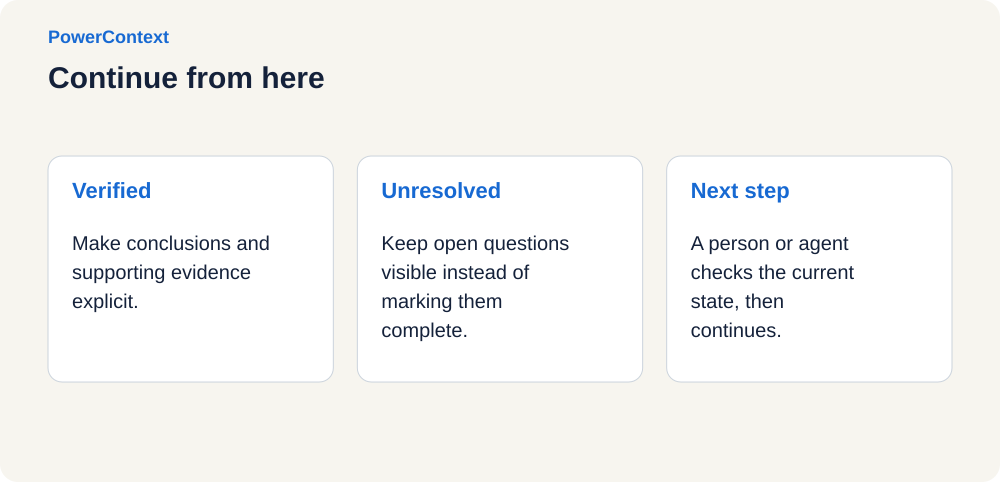](../../../assets/blog/powercontext-1-0-0-release/figure-16.en.svg "View full-size diagram")

PowerContext repository: https://github.com/oceanbase/powercontext

We also want to thank everyone who has contributed to PowerMem and PowerContext. Code implementation, agent integrations, tests and evaluations, documentation improvements, issue reproductions, and design discussions have all moved the project forward. Thank you as well to the users who have brought it into their real work.


*Original contributor montage.*

## What will be scarce is not agents that answer better, but systems that keep work from being lost

### What comes next

We plan to continue in three directions:

- Improve effectiveness: make collection, retrieval, and use more observable, and continue tracking quality, latency, and cost.
- Improve usability: make handoff and recovery easier, deepen host integrations, and improve sharing, permissions, auditing, and operations.
- Improve reliability: strengthen conflict and staleness handling, and bring task results and user feedback into a verifiable, reviewable process for evolving Experience and Skill.

These directions still need to be tested through real work. A reproducible failure case or a handoff record that exposes an omission will help us see what still needs improvement.

### Closing thoughts

When work crosses sessions, models, and participants, it needs to carry verified judgments, unresolved questions, and the evidence for each.

**PowerContext preserves that history and organizes unfinished work for the next participant.**

When a session ends, the next participant should not have to start again with “First, tell me about the project.” They should first see the current goal, the approaches already taken, what still needs verification, and where the evidence is, then continue from there.

[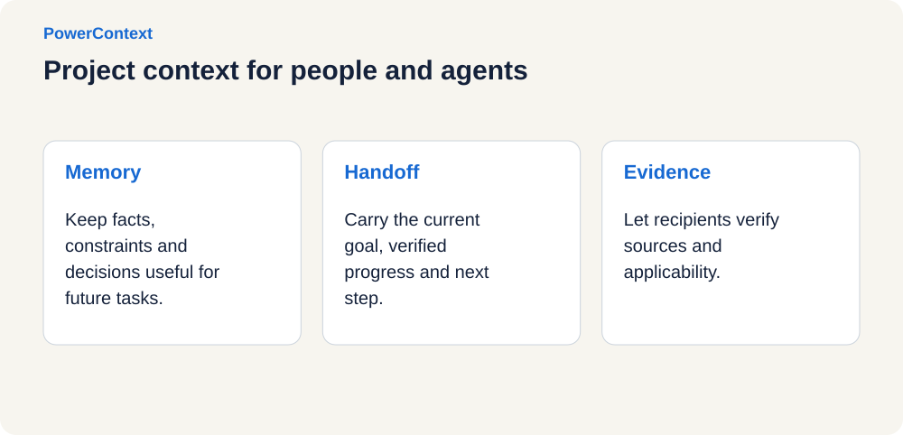](../../../assets/blog/powercontext-1-0-0-release/figure-18.en.svg "View full-size diagram")

## References

[^1]: [Alfred, Lord Tennyson, Ulysses](https://www.poetryfoundation.org/poems/45392/ulysses)

[^2]: [Organizational background as part of agent capabilities](https://openai.com/index/inside-our-in-house-data-agent/)

[^3]: [A stateful runtime environment for agents](https://openai.com/index/introducing-the-stateful-runtime-environment-for-agents-in-amazon-bedrock/)

[^4]: [Long-running research](https://www.anthropic.com/research/long-running-Claude)

[^5]: [Symphony](https://openai.com/index/open-source-codex-orchestration-symphony/)

[^6]: [Context Hub](https://www.langchain.com/blog/introducing-context-hub)

[^7]: [Production-ready agent guides](https://cloud.google.com/blog/topics/developers-practitioners/five-guides-to-building-and-scaling-production-ready-ai-agents)

[^8]: [Build 2026](https://blogs.microsoft.com/blog/2026/06/02/microsoft-build-2026-be-yourself-at-work/)

[^9]: [Multi-agent collaboration experiments](https://www.anthropic.com/research/multiagent-systems)

[^10]: [Trustworthy agents in practice](https://www.anthropic.com/research/trustworthy-agents)

[^11]: [Agent integration guide](https://powercontext.oceanbase.io/en/docs/tutorials/agent-quickstart/)
