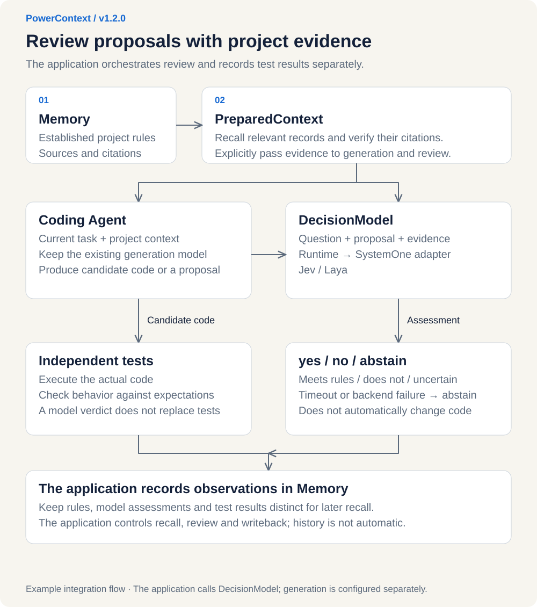
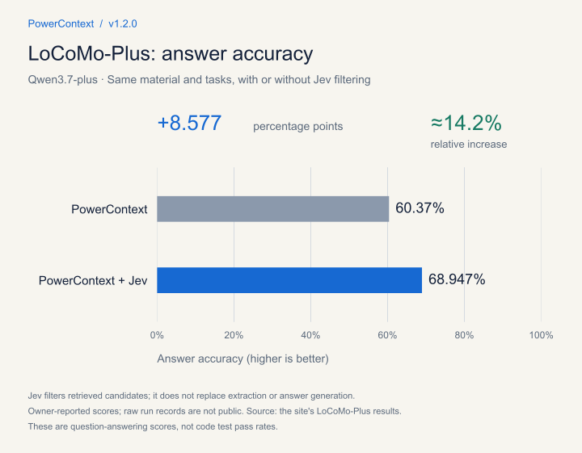
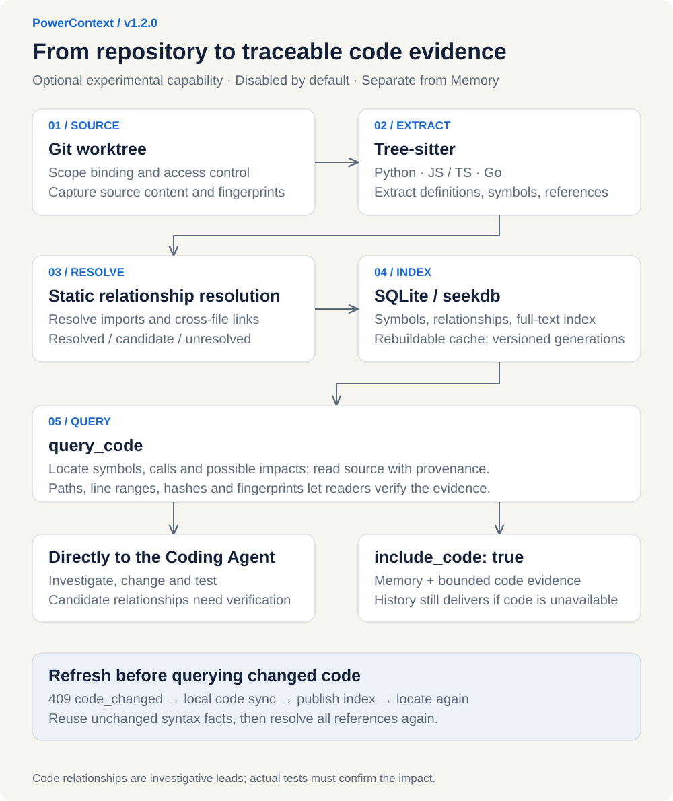
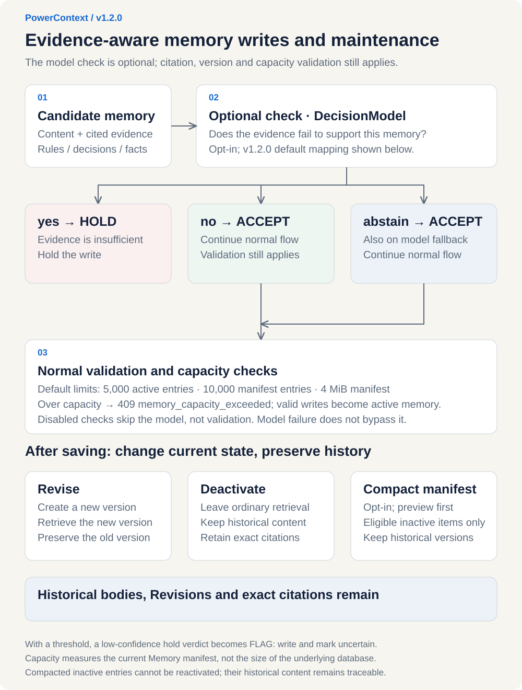

Ask a Coding Agent to write a routine for handling monetary amounts, and the task sounds simple. Put it into a real project, though, and there is much more to consider: how to round fractions of a cent, whether refunds should follow the same rules, and whether behavior that existing customers rely on can be changed.

The team may have discussed these details long ago, but an Agent just picking up the task does not know them. Even after the rules are explained, another question comes up when changing the code: where is this logic, and what uses it? A change that appears to touch just one function can affect an order page, billing exports, or an after-sales workflow. Coding Agents have to combine commands such as head, cat, and grep to find related code, which is inefficient and consumes a lot of tokens.

OceanBase PowerContext v1.2.0 is out today!

The focus is on making these two kinds of evidence easier for Coding Agents to use in project work. Existing project memories can be passed to a decision model to check whether a proposed solution follows the team's agreements. The new native code understanding capability helps Coding Agents investigate the current repository and find relevant implementations and call sites before making changes.

## 1. Preserve project experience to ground decisions and code changes

Continuing with the example above, first look at the rules the team has already established.

While working on refunds last week, for example, the team agreed on how monetary amounts should be rounded and ruled out an approach that did not fit the project. If those conclusions remain only in that discussion, they will have to be explained again when the next task begins.

PowerContext's existing memory capabilities preserve those conclusions together with the evidence behind them.

Why an older version still needs support, why a seemingly simple change has never been made, or why an approach was abandoned can all be saved as project records.

When a new task begins, an application or AI tool configured for recall can find relevant records in a selected project based on the current question and assemble them into context for the task. Developers can also ask the AI to look them up directly. When verification is needed, they can trace the sources and historical versions to decide whether earlier conclusions still apply.

This is part of what context engineering addresses: selecting the information the current task needs and preserving information that will be useful later. Anthropic also emphasizes the selection of relevant information and the role of long-term notes in its introduction to context engineering. (See: https://www.anthropic.com/engineering/effective-context-engineering-for-ai-agents)

With these records in place, the next question has a foundation: how can a model check a proposed solution against the project's own rules?

## 2. How do decision models integrate?

A question such as “Does this implementation comply with the rules for handling monetary amounts?” does not call for another proposal from the model. It calls for a judgment on a specific question.

Defining the question and the possible answers in advance, then supplying the material needed to make the judgment, is how decision models are used.

* TypeSafe's Jev entered early access on September 15, 2026. It makes choices, assigns scores, or gives judgments on specific questions. LangChain has also described how to use it for AI evaluation and specific tasks.

  Jev announcement (see: https://typesafe.ai/blog/introducing-system-one-models-and-jev)

  LangChain application guide (see: https://www.langchain.com/blog/building-prod-with-jev-and-langgraph)

* Two weeks later, on September 29, OpenAI announced the Decisions API at DevDay, also targeting judgments with a bounded set of answers. It uses Luna. Developers can define a set of questions, each with a finite set of predetermined answers, provide text or images as context, and use the results to classify content, route requests, or choose an agent's next step.

  DevDay 2026 recap (see: https://openai.com/zh-Hans-CN/index/devday-2026-recap/)

A model can make judgments, but we still need to supply the rules of the project.

PowerContext v1.2.0 provides a DecisionModel interface that puts the question, the material to be assessed, and the project evidence into a single request.

Integration examples are available for Jev and Laya. The diagram below shows the integration logic: Select a diagram to view it at full size.

[](../../../assets/blog/powercontext-1-2-0-jev/decision-flow.en.svg "View full-size diagram")

### An example: the team rules behind a single cent

Return to the task of handling monetary amounts.

The team has already agreed on rounding, refund rules, and how invalid amounts should be handled. A generic implementation may not meet those requirements.

* The PowerContext example first saves the rules as project memories, then retrieves the relevant records when preparing context.

* The Coding Agent uses those records to write a solution. The decision model receives the same records and checks the solution against the same rules. Connecting a model does not automatically give it the project's history; the relevant evidence must be passed in explicitly.

* The decision model's assessment must also be considered separately from the program's actual behavior.

The example asks the same Coding Agent to perform the task twice: once with only the current requirements, and once with the project's existing rules as well. Both solutions are passed to Jev or Laya for review, then independent tests check the programs' actual results.

This produces separate records of whether the historical agreements reached the model, whether the model's judgment met the requirements, and whether the program actually behaved correctly.

The model's assessment and the test results are preserved separately. At the end of the task, the example also writes its observations back to project memory. When a similar issue comes up later, the team can look up which rules were used, which cases were checked, and what the results were.

### Keep using the same Coding Agent

Integration can begin with a checkpoint after a solution has been generated, while keeping the same model for writing code.

The application selects the project context and arranges the workflow. It then uses DecisionModel to pass in the question, the proposed solution to inspect, and the recalled evidence, receiving yes, no, or abstain (unable to determine at present).

The interface is vendor-independent. It does not appear in the Coding Agent's tool list; the application calls it when a judgment is needed.

The following code shows how, after integrating Jev with PowerContext, a saved rule can be retrieved and submitted to the model alongside candidate code for review:

```python
# 1. Configure Jev using credentials from environment variables.
provider = SystemOneConfig(
    provider="jev",
    endpoint=os.environ["JEV_ENDPOINT"],
    model=os.environ["JEV_MODEL"],
    api_key=SecretStr(os.environ["JEV_API_KEY"]),
)
backend = SystemOneDecisionModel(provider, client)

# 2. Pass the adapter to PowerContext.
async with open_builtin_runtime(
    config,
    decision_model=backend,
    scheduler_path=directory / "scheduler.db",
) as runtime:
    memory = runtime.memory.for_scope(scope.scope_id)
    record = await memory.get(
        GetMemoryEntryRequest(citation=saved.entry.citation)
    )

    # 3. Submit the question, candidate code, and project rules together.
    result = await runtime.decision_model.evaluate(
        DecisionRequest(
            decision_kind="example.invoice-review",
            question="Does this implementation satisfy every monetary conversion rule in the evidence?",
            subject="def cents(text):\n    return round(float(text) * 100)",
            evidence=(record.entry.text,),
        )
    )
    print(result.outcome.value, result.used_fallback)
```

The respective adapters handle Jev's and Laya's request formats. Callers use the same PowerContext DecisionModel interface.

Teams that want to deploy a decision model in their own environment can integrate Laya and compare its performance on real tasks. When changing decision models, they can adjust the corresponding adapter while retaining the existing Coding Agent, project memories, and subsequent tests.

If the decision service is temporarily unreachable, this step returns abstain, allowing the solution and its tests to continue. For an “unable to determine at present” result, the team can supply more evidence or carry out another review. PowerContext provides runnable examples, with decision models connected to DecisionModel through adapters.

## 3. Are the additional judgments useful after integrating a decision model?

The example above shows how a decision model can be connected to the PowerContext runtime with just a few lines of code to make judgments during context preparation. How well does it work in practice?

Before the release, we ran a LoCoMo-Plus benchmark to find out.

PowerContext's existing workflow already retrieves relevant records. This comparison uses the same material and tasks, adding Jev to the existing workflow so it can participate in context selection, judge which material is more useful for answering the current question, and let us observe changes in final answers and runtime cost. “PowerContext + Jev” in the chart refers to this additional judgment step.

[](../../../assets/blog/powercontext-1-2-0-jev/benchmark.en.svg "View full-size diagram")

The chart shows the question-answering results for Qwen3.7-plus. Adding Jev increased answer accuracy from 60.37% to 68.947%, a relative improvement of approximately 14.2%. These figures describe how selecting historical material helps question answering. The correctness of the code in the earlier monetary-amount example is still checked by independent tests.

## 4. Native code understanding: help Coding Agents understand the repository

Return once more to the monetary-amount task.

Even when the rules are clear, a Coding Agent changing an existing implementation still needs to find the relevant code and understand what uses it. Project memory explains why earlier decisions were made; the current implementation and its call relationships must be investigated in the repository itself.

For example, when changing how refund amounts are calculated, order pages, billing exports, and after-sales workflows may all use that logic. Understanding these connections before making changes tells you what needs to be checked next.

PowerContext v1.2.0's native code understanding provides this kind of investigative capability. The following diagram shows how it works:

[](../../../assets/blog/powercontext-1-2-0-jev/code-understanding.en.svg "View full-size diagram")

### See the connections before making changes

After receiving a task, the Coding Agent can find relevant code, inspect related parts, read their contents, and continue investigating from there. Before changing shared logic, it can check who uses it; when reviewing a change, it can focus on the parts that may be affected. Query results retain specific source locations. Developers can return to the code to verify the Agent's suggestions, and a colleague or another tool taking over can follow the same leads.

With this capability enabled, PowerContext's existing context packages can contain both relevant project experience and a small amount of evidence from the current code.

For example, a historical record might say, “Existing customers still depend on this feature, so its behavior cannot be changed yet.” Code investigation then helps the Agent locate the corresponding implementation and its uses. With concrete code to compare against the team's agreements, the boundaries of a change become easier to explain.

### When the code changes, the understanding must change too

Repositories keep changing, so previously discovered relationships cannot be relied on indefinitely. PowerContext checks for code changes when a query is made. If the earlier analysis is stale, it requires an update before that analysis can be used again.

Historical records and current code analysis are stored separately to make verification easier. An approach from a year ago can serve as a reference, but whether it still applies today depends on the current implementation.

Native code understanding is currently an optional experimental capability. It provides investigative leads and traceable evidence; the final impact of a change still needs to be confirmed through actual tests. You can enable it for a specific change first and see whether the Coding Agent finds the locations that need checking more quickly.

## 5. Memory governance: keep shared experience usable

From recalling rules and reviewing solutions to investigating code, the evidence left in a project is used repeatedly. At the end of a task, the team can save new observations as well.

As records accumulate, they need ongoing maintenance: which conclusions are still valid, which are outdated, and which were only hypotheses at the time? “This approach should solve the problem” and “This approach was verified under these conditions” are very different kinds of help for whoever takes over next. Saving the conditions and evidence alongside the record gives them something to verify.

PowerContext v1.2.0 adds an optional memory quality check before saving. The diagram below shows the process:

[](../../../assets/blog/powercontext-1-2-0-jev/memory-governance.en.svg "View full-size diagram")

This also uses DecisionModel.

The check asks whether the existing citations support the memory. If they do not, the write is paused or the memory is marked for verification. If the result is abstain, or the decision service is unavailable, the write proceeds so that a model failure does not prevent a record from being saved. These checks provide an additional assessment; the content still needs to be maintained based on actual results.

Records that have already been saved can also be adjusted.

PowerContext's existing memory management supports revisions, allowing outdated records to leave everyday retrieval while preserving their history. When a team changes an agreement, subsequent work uses the updated content, while the original choice remains available for review. As records grow, teams can also manage the size of the active memory set and clean up invalid records that meet the relevant criteria. Practices worth reusing can be recorded with the circumstances, actions, and actual results, then organized into experiences for later reference after review. More stable procedures can be turned into skill guides and used after review and export to supported tools.

This gives the information left by one task a chance to help with later work.

## 6. Integrate with everyday tools

For these capabilities to become part of everyday work, they need to connect to the tools developers already use.

PowerContext already supports AI tools such as Codex and Claude Code, allowing developers to look up background information, save memories, and hand off work in those environments.

This release also expands the ZCode community integration to cover the command line and Windows desktop.

For example, if you need to move from a terminal to a desktop client halfway through investigating refund logic, you can prepare a handoff in advance, preserving the goal, confirmed facts, blockers, and next steps. The Coding Agent taking over can read the existing conclusions and verify the current situation without repeating the investigation from the beginning. The same approach can carry work forward when changing people or sessions.

Get started with a single prompt:

```text
Help me install and use PowerContext. Repository: https://github.com/oceanbase/powercontext
```

## 7. Start with one checkpoint and one code change

To try this update, start with a task already on your plate.

If your project has established business rules, add a check after solution generation and pass the rules and the solution to Jev or Laya. Keep the original Coding Agent writing code, then see whether the model judges according to the agreements and whether the program actually behaves correctly.

If you are about to change code that is used in several places, enable native code understanding and have the Coding Agent investigate the relevant implementation and call sites first. Follow the source locations it provides to verify the findings, then make the changes and test them. The next time a task such as handling monetary amounts comes up, the team's established rules can guide the model's judgment, and the repository's call relationships will have traceable sources.

**PowerContext · Not only memory, but a full story.**

Project: https://github.com/oceanbase/powercontext
