> 一路所遇，皆融于我。
>
> —— 阿尔弗雷德·丁尼生，《尤利西斯》[^1]

## AI Native 组织困局

AI 时代中，一个屡见不鲜的场景就是：Agent 已经把一个难查的重复提交问题推进了一半，代码改过，测试跑过，两条不合适的路也排除了。第二天，后续的工作被交接到另一位同事，或者换到另一个 Agent，一切又从“先介绍一下项目背景”开始。

代码在仓库里，日志也还在。最要紧的几句话却留在昨天的会话里：为什么选这条路，哪些约束不能碰，哪一步只是猜测。后来者看得见结果，却看不见来路。很多工作没有失败，只是断在了交接处。

[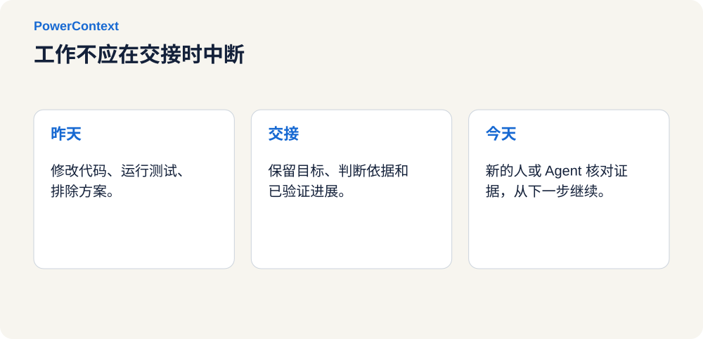](../../../assets/blog/powercontext-1-0-0-release/figure-01.zh.svg "查看大图")

这篇文章想和大家讨论的，就是这个“断点”：当工作跨过会话、工具和参与者，怎样让已经完成的思考和验证被下一位接着使用？

PowerContext 就正在尝试把这件事做成一层独立的工作上下文。它把当前目标、判断依据、已验证进度和下一步留在工作旁边，让新来的人或 Agent 不必从整段聊天记录里重新拼出前因后果。

## 新共识：AI Agent 瓶颈正在从执行转向协作

2026 年公开的多项实践，虽然没有给出同一套答案，却把一个共同的麻烦摆到了台面上：Agent 接受的任务越来越长，一项工作开始跨过更多会话、工具和参与者。

任务一长，运行环境就需要记住上一步发生了什么。

[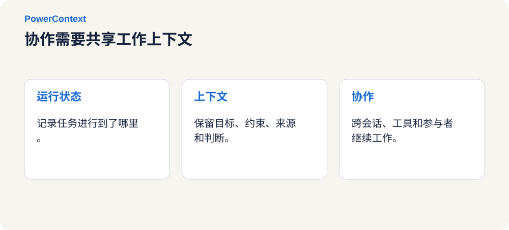](../../../assets/blog/powercontext-1-0-0-release/figure-02.zh.svg "查看大图")

**1 月，组织背景成为 Agent 能力的一部分[^2]。** OpenAI 的内部数据 Agent 把表结构、人类标注、代码、组织知识、记忆和运行时状态放在一起使用。模型知道怎样写 SQL，还需要知道公司究竟怎样定义一个指标、哪些数据可以一起算。

**2 月，状态开始跨越单次请求。** AWS 与 OpenAI 公布了带状态的 Agent 运行环境[^3]，让运行环境承接跨步骤、工具、审批和系统状态的生产任务。

**3 月，跨会话的进度记录成为长任务的必需品。** Anthropic 在持续科研工作[^4]中专门维护进度文件，记录当前状态、验证结果和失败路线，让后续会话不用再试一次已经走不通的路。

**4 月，人的上下文切换成为瓶颈。** 参与者多起来后，协调成本也跟着上升。OpenAI 在 Symphony[^5] 的实践中观察到，工程师通常只能舒适地同时管理三到五个会话。这只是一个团队的观察，并非所有人的固定上限。

**5 ~ 6 月，上下文开始被独立管理。** LangChain 发布了 Context Hub[^6]，用来存储、版本化、协作和发布上下文文件。Google Cloud 则在生产级 Agent 指南[^7]中，把检查点、恢复与人工审批放进长任务的运行机制。Microsoft 同期在 Build 2026[^8] 上推出连接人员、邮件、文档、会议和业务数据的上下文能力。

7 ~  8 月，Anthropic 公布的多 Agent 协作实验[^9]已经观察到代码合并冲突、彼此隔离的工作方式，以及多个 Agent 趋同决策造成的集体错误。

这些实践，分别处理运行状态、上下文内容和多人协作，但指出了一个共同问题：执行越来越便宜，协调和核验的成本开始显眼。放在一起看，聊天窗口已经很难独自承担一项长期工作的全部来路。

多开几个 Agent，可以增加执行能力。可这个结果属于哪个任务、基于哪版代码、下一位能不能直接用，仍然需要明确的记录和检查。

[](../../../assets/blog/powercontext-1-0-0-release/figure-03.zh.svg "查看大图")

## 破局之法：协作的第一步，是让工作可离开会话

复杂任务经常跨过多个边界：对话窗口会满，模型会换，工程师会下班，工作也会从研发转到测试、售前或值班。每跨一次边界，接手者都要重新确认几件事：

* 现在要完成什么？
* 哪些结果已经验证，证据在哪里？
* 哪些方案试过但被放弃，原因是什么？
* 哪些问题还没有答案，接手者先做什么？

聊天记录、Memory 和 Handoff 都和上下文有关，但各自承担的职责不同。

[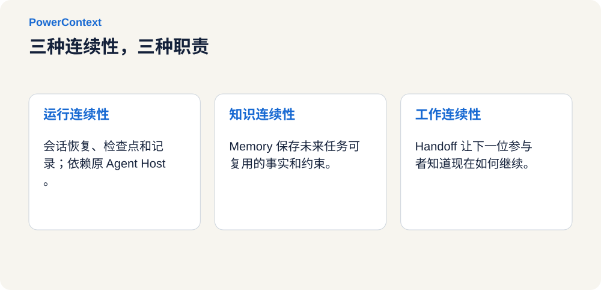](../../../assets/blog/powercontext-1-0-0-release/figure-04.zh.svg "查看大图")

**运行连续性**，处理同一个会话怎样接着跑。`resume`、checkpoint 或 transcript 能让同一个 Agent Host 找回先前状态，这些状态通常仍然依赖原来的工具和会话格式。

**知识连续性**，保存以后还会用到的事实、约束和决策。Memory 和 RAG 可以找回“目标环境没有 Redis”或“本期不做历史补偿”这类信息，却不一定说明眼前的工作进行到了哪里。

**工作连续性**，告诉下一位参与者现在怎样继续。Handoff 组织当前目标、已验证进度、阻塞、下一步和证据。接手者可以是新会话、新模型、另一个 Agent Host，也可以是人。

运行状态留给 Agent Host，跨任务仍有价值的判断进入 Memory，正在推进的工作通过 Handoff 交给下一位。混在一起保存，只会让记录越来越长。

> Memory 回答“以后还应该记住什么”。
>
> Handoff 回答“下一棒现在怎样接着做”。

MCP 负责连接工具和数据，A2A 让 Agent 发现并调用其他 Agent，checkpoint 恢复一次运行。未完成的工作离开原会话时，还需要一份独立于单个 Agent Host 的交接状态。

## 非共识：PowerContext 三个选择

PowerMem 解决长期记忆之后，我们遇到一个更具体的问题：一项尚未完成的工作，怎样交到下一位手上？这个问题促成了 PowerContext。

PowerContext 是面向人机协作的上下文运行层。它从知识库、工单、代码仓库和可观测系统中引用与当前工作有关的材料，再把目标、证据、判断、进度和下一步组织成可以继续使用的项目上下文。

> **Memory 让事实不被忘记，Handoff 让工作不必重来。**

[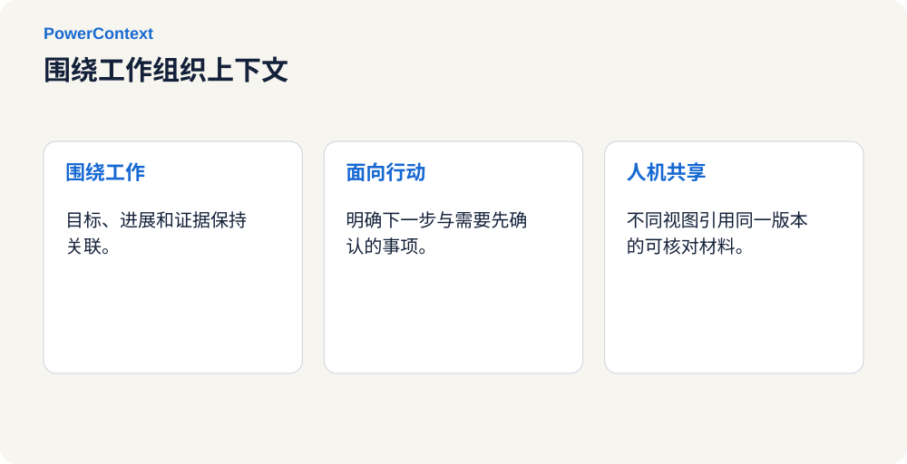](../../../assets/blog/powercontext-1-0-0-release/figure-05.zh.svg "查看大图")

PowerContext 把三个约束写进产品设计。上下文围绕正在推进的工作组织，保留信息之间的关系；交接内容以接手者能否继续行动为准，不把全量日志重新塞进窗口。

接手者既可以是 Agent，也可以是人。Anthropic 在可信 Agent 实践中同样强调人类控制、透明度，以及在合适的时候把决定交还给人。Trustworthy agents in practice[^10]

后面的设计围绕三个问题展开：工作能否顺利交接，交接内容是否可信，以及它能否跟随项目进入另一个 Agent 环境。

## PowerContext 的答卷：接得住、信得过、带得走

### 接得住：让 Handoff 承载未完成的工作

Handoff 面向一项尚未结束的工作。它要让接手者知道怎样行动，也知道哪些地方应该先停下来确认。开头那个组合场景，可以整理成下面这份工作包：

| 项目 | 内容 |
| --- | --- |
| 目标 | 在下一个灰度窗口前修复重复提交 |
| 范围 | 本次只处理重复写入，历史补偿另行评估 |
| 已验证 | 使用同一个请求标识回放，可以稳定复现问题 |
| 已放弃 | 分布式锁方案会显著增加对账链路延迟 |
| 环境约束 | 目标环境没有缓存集群，方案需适用于现有数据库环境 |
| 待核实 | 数据库改动对现网的影响、旧客户端的兼容性 |
| 下一步 | 完成数据库风险审查和兼容性验证，再由人决定是否灰度 |
| 证据 | 复现日志、环境说明、对应的代码版本及测试条件 |

“待核实”需要和“已验证”一样显眼。只留下好消息，接手者很容易把尚未验证的部分也当成结论。这份工作包同时给出下一步和继续之前还欠下的证据。

[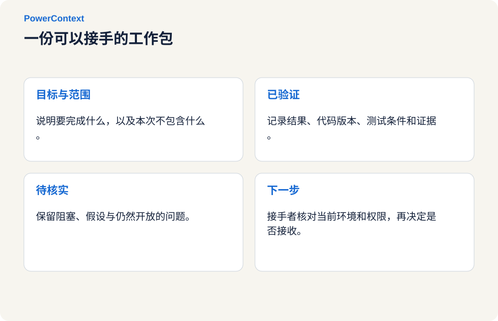](../../../assets/blog/powercontext-1-0-0-release/figure-06.zh.svg "查看大图")

委托时先写清目标和完成边界，再由人或 Agent 整理进度、阻塞、下一步及其证据。需要保留里程碑时，将工作包提交为可追溯版本；任务结束、受阻或中断时，再记录结果和检查证据。

接收方对照当前仓库、当前指令、自己的能力和权限，选择接受、请求澄清或拒绝接手。

交接发出、确认接手和任务完成分别记录，团队可以据此判断工作停在哪一步。接手确认本身不增加操作权限，发布仍须满足当前授权要求。

交接默认服务于当前任务，不会自动成为长期 Memory。某个方案为何被否，先跟着本次问题处理；长期有效的环境约束，再单独写入 Memory。人和 Agent 可以阅读同一版本的不同视图：人先看业务影响、取舍和待决定的问题，Agent 再展开执行细节与检查步骤，引用仍落在同一组可核对的材料上。

### 信得过：让上下文有来源、有边界

模型拿到更多历史时，过期判断、错误总结、恶意内容和无关噪声也可能一起进入窗口。群里的猜测、环境说明和测试日志，证据地位各不相同；某次测试只对一版代码和一组条件有效，某个环境约束也不能直接变成全产品规则。

[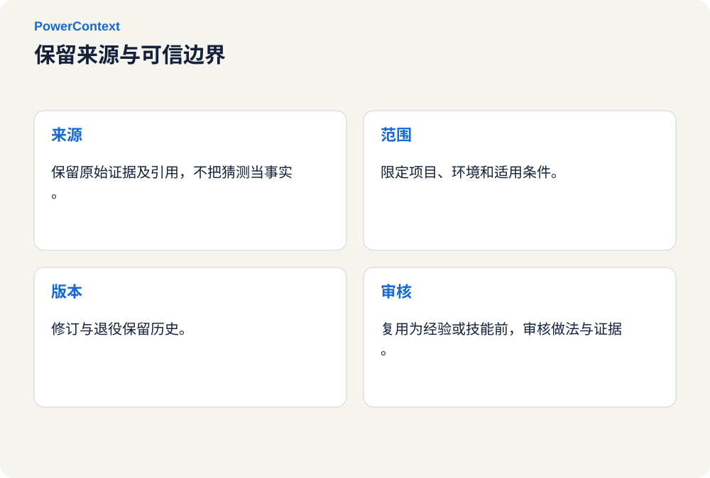](../../../assets/blog/powercontext-1-0-0-release/figure-07.zh.svg "查看大图")

Source 记录来源与证据边界，捕获一段提示词不会让其中的每句话直接进入长期 Memory。经过筛选的内容进入 Memory / Artifact，修订和停用保留历史，每次变化都能追溯到来源。

Server 按当前 Scope、相关性和字节预算生成 PreparedContext，默认请求预算上限为 8,000 UTF-8 bytes；召回失败时采用降级策略，不阻断原本的工作。Agent 或调用方可以提交 Experience、Skill 候选，通过 Review 后再形成不可变资产。

企业项目中的范围变化、接口约束、历史承诺和未决事项，常常散落在 CRM、工单、邮件和会议记录里。检索命中只说明它可能有关，Scope、`revision` 和 `citation` 还要回答它属于哪个项目、出自哪次判断、依据在哪里。

一次成功不会直接成为团队规则。在一个仓库成立的命令，换个环境可能造成破坏。做法需要连同证据进入 Review，再决定是否沉淀为 Experience 或 Skill。

### 带得走：Agent 可以换，项目上下文不必重来

团队往往会同时使用不同模型、框架、IDE 和 Agent。今天在 Codex 里调试，明天可能在 Claude Code 里 Review；一支团队用 LangChain 构建业务 Agent，另一支团队用 LangGraph 编排流程。

PowerContext 把 Server 作为独立运行层：

* 本地开发可直接使用 OceanBase seekdb 作为底层数据存储，团队部署可选 OceanBase 集群；
* 通过 HTTP/OpenAPI 与 Streamable HTTP MCP 暴露统一能力；
* 项目 Scope、保留历史的 `revision`、`citation`、Handoff 与 Review 契约由 Runtime 维护；
* Agent 集成负责在合适的时机采集、召回和呈现，共享同一套上下文契约。

[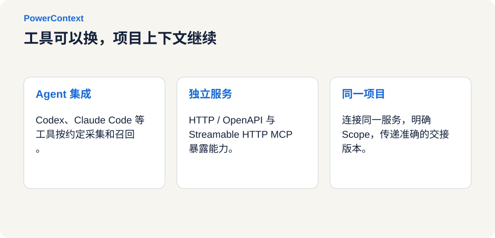](../../../assets/blog/powercontext-1-0-0-release/figure-08.zh.svg "查看大图")

当前项目已经提供 Codex、Claude Code、DeepSeek Harness、Hermes Agent、Pi Coding Agent、OpenClaw、OpenCode、WorkBuddy、Bub、Pydantic AI、LangChain 和 LangGraph 共 12 个集成。参与者连接同一服务、选择同一项目 Scope，并接收明确版本的 Handoff 后，可以从当前状态继续工作。

## 一段工作如何穿过 PowerContext

PowerContext 的主路径可以压缩为五步。它不是把所有信息搬进一个新系统，而是在现有系统之上建立证据与工作状态的连接。

[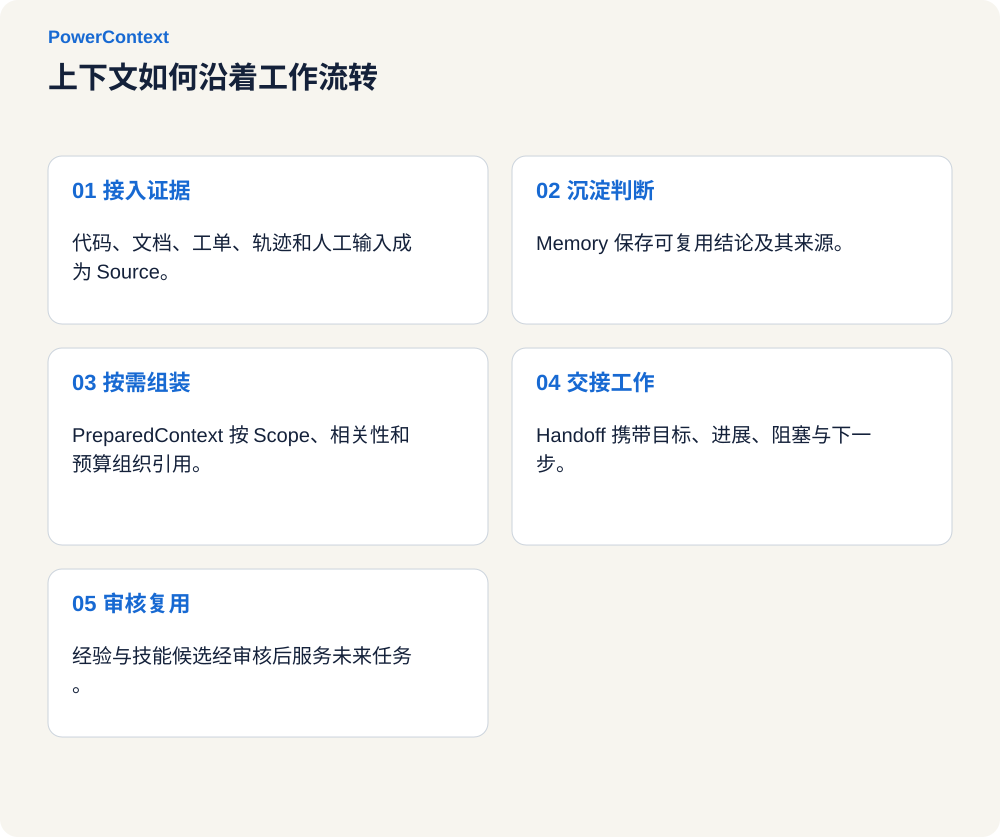](../../../assets/blog/powercontext-1-0-0-release/figure-09.zh.svg "查看大图")

* **第一步，把证据接进来。** 代码、文档、工单、trace、Agent 轨迹和人工输入都可以成为 Source。PowerContext 关心来源引用与证据关系，不取代用户已有的数据系统。
* **第二步，沉淀值得复用的判断。** 决策、约束、结果和状态可以被显式记录；配置生成模型后，也可以从 Source 中抽取候选信息。每条 Memory 保留来源，后续修订与停用不抹掉历史。
* **第三步，在需要时组装有界上下文。** Agent 收到请求前，Runtime 按项目 Scope、相关性与预算生成 `PreparedContext`，并附上 `citation`。目标不是交付“所有可能相关的内容”，而是“完成下一步所需的最小充分上下文”。这与 Anthropic 提倡的 即时上下文与渐进式披露 方向一致：保留轻量引用，在运行时按需展开，而不是预先塞满窗口。
* **第四步，在参与者切换前形成 Handoff。** 目标、已验证进度、阻塞、下一步和证据被整理为工作包，交给新会话、新任务、新模型、新 Agent Host，或者下一位人。
* **第五步，让复用产生反馈，但不绕过治理。** 经过多次任务验证的做法进入 Experience / Skill Candidate 与 Review 流程；真正被批准的资产再服务未来工作，形成一个由人类控制的复用闭环。

这五步连成一条可追溯的工作链路。它是否真的减少重来、改善任务结果，还要由评测回答。

## 它是否真的改善结果：把答案交给公开评测

上下文产品很容易用一段聪明的 Demo，或者几条召回结果证明自己。PowerContext 同时观察两件事：长程记忆问答的准确率与成本，以及 Coding Agent 的任务完成率。

### LoCoMo：不是把历史全塞进去，而是找对、找快、给得刚好

LoCoMo 是长对话记忆公开数据集。PowerContext 的端到端评测包含 10 段对话、272 个会话、5,882 个对话轮次和 1,986 个问题，其中类别 1～4 共 1,540 题进入计分。

[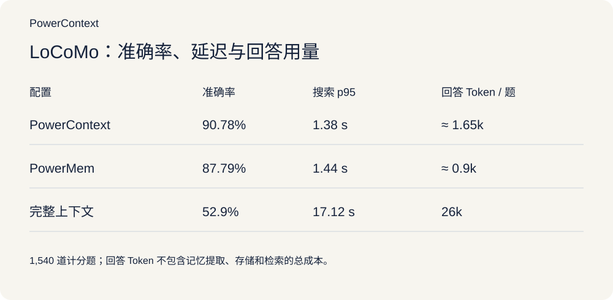](../../../assets/blog/powercontext-1-0-0-release/figure-10.zh.svg "查看大图")

与 全量上下文基线相比，PowerContext 的准确率高 37.88 个百分点，搜索 p95 低约 91.9%，单题回答 token 少约 93.7%。与 PowerMem 相比，准确率提高 2.99 个百分点，搜索 p95 略低，回答 token 则高于 PowerMem。

[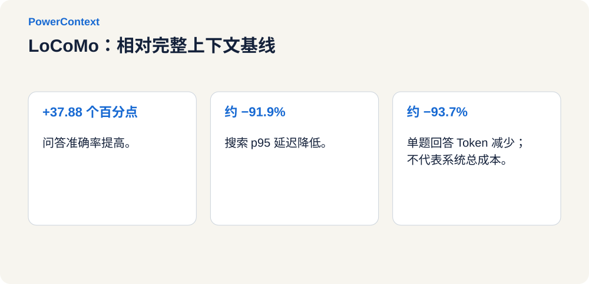](../../../assets/blog/powercontext-1-0-0-release/figure-11.zh.svg "查看大图")

### SWE-bench Pro public v2：上下文最终要落实到任务结果

记忆问答测量信息能否被找回，Coding Agent 评测更接近任务能否完成。PowerContext 在 Codex 环境中对 SWE-bench Pro public v2 的 731 个任务做了 OFF / ON 对照，两组均使用 `gpt-5.6-sol`，推理等级为 `medium`：

[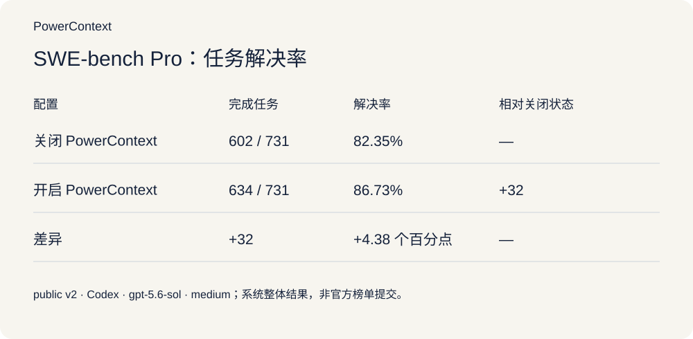](../../../assets/blog/powercontext-1-0-0-release/figure-12.zh.svg "查看大图")

| 配置 | 完成任务 | 任务解决率 |
| --- | --- | --- |
| 关闭 PowerContext | 602 / 731 | **82.35%** |
| 开启 PowerContext | 634 / 731 | **86.73%** |
| 差异 | **+32** | **+4.38 个百分点** |

[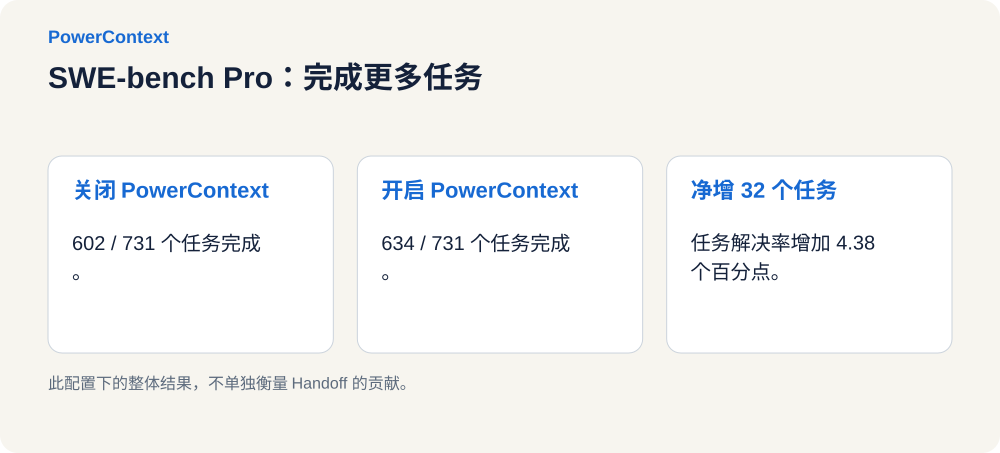](../../../assets/blog/powercontext-1-0-0-release/figure-13.zh.svg "查看大图")

在这组任务和配置下，结果给出了一个积极信号：**PowerContext 的效果可以放到真实 Agent 任务的完成率上进行检验。**

## 小试牛刀：用 3 分钟开始一次真实体验

以下以 macOS 或 Linux 上的本机 Codex CLI、PowerContext 1.0.0 为例。先准备 Python 3.11+、Git、uv 和已安装的 Codex CLI。

安装并启动服务：

```bash
uv tool install "powercontext[cli,server]==1.0.0"
powercontext server run
```

在没有自定义配置时，Server 监听 `127.0.0.1:8000`，使用本地持久化 SQLite。保持这个终端运行。

另开终端，进入要体验的项目，安装匹配版本的集成并检查：

```bash
powercontext setup codex --ref powercontext-v1.0.0
powercontext doctor
powercontext doctor codex
codex
```

确认新会话加载了 PowerContext Hook 和 MCP，并核对 Server 地址、认证配置及 Scope。多个项目需要隔离时，应显式配置 Scope，不能只靠切换目录。完整步骤见 Agent 接入指南[^11]。随后可以做三次检查：

[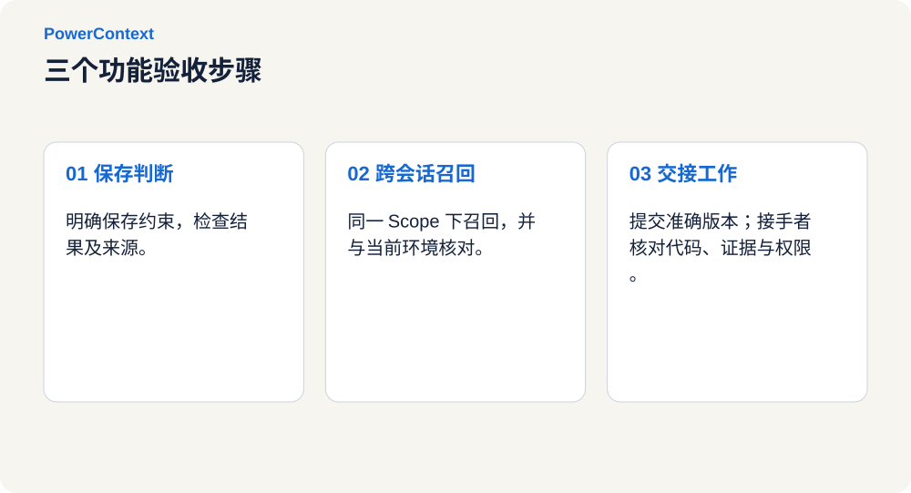](../../../assets/blog/powercontext-1-0-0-release/figure-14.zh.svg "查看大图")

1. **保存一条约束。** 明确要求把一条后续仍然有效的项目判断保存到 PowerContext，检查保存结果及来源引用。
2. **换会话取回。** 在同一 Scope 的新会话里询问这条判断，检查内容是否正确、引用是否可核对。复述成功不代表结论仍然有效，还要结合当前环境判断。
3. **交出未完成的工作。** 要求使用 PowerContext 交接当前工作，检查实际状态，提交 Handoff，并给出精确版本。把该版本交给接收方，让他先核对代码、证据和权限，再确认是否接手。

`doctor` 通过只说明相应诊断检查通过，不能代替这三次业务验收。

显式 Memory 操作和手工整理、提交 Handoff，不要求预先配置 PowerContext 服务端的生成模型。自动提取记忆、向量搜索等能力则需要相应的生成和 Embedding 配置。Agent 的订阅登录不会自动为 Server 提供模型 API。

> 说明：
>
> 本地默认使用数据库保存上下文，并提供看板。涉及跨工具交接时，让双方连接同一服务，并明确选择同一个项目 Scope。连接到同一个服务，不代表已经选中了同一份项目上下文。

## 坚定开源，上下文基础设施必须可检查、可扩展、可带走

项目上下文会参与 Agent 的判断，也承载团队的工作历史。存了什么、为什么召回、谁改过、如何迁移，这些问题都应该能被检查。

[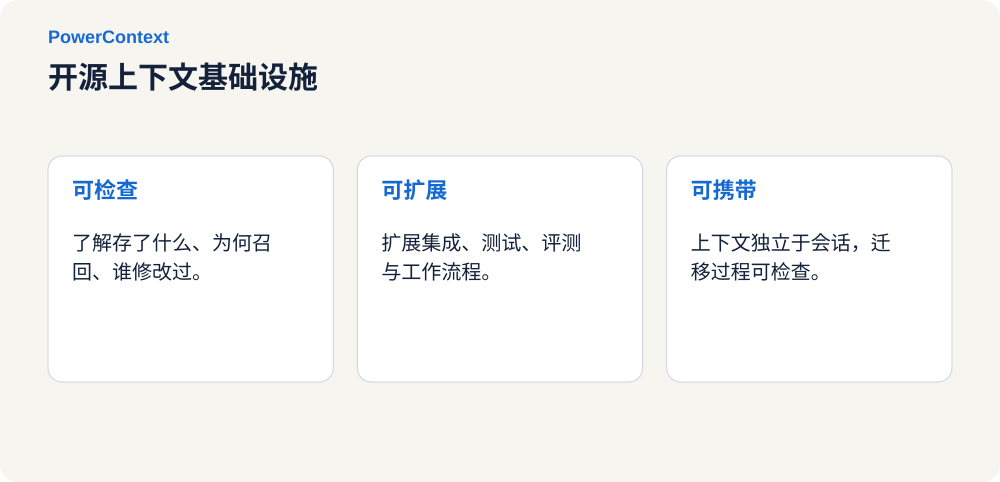](../../../assets/blog/powercontext-1-0-0-release/figure-15.zh.svg "查看大图")

PowerContext 采用 Apache License 2.0 开源，仓库公开运行时、Server、OpenAPI 契约、集成、设计文档和评测工具。团队可以检查这些机制，也可以把自己的失败案例和验收方式补进来。

[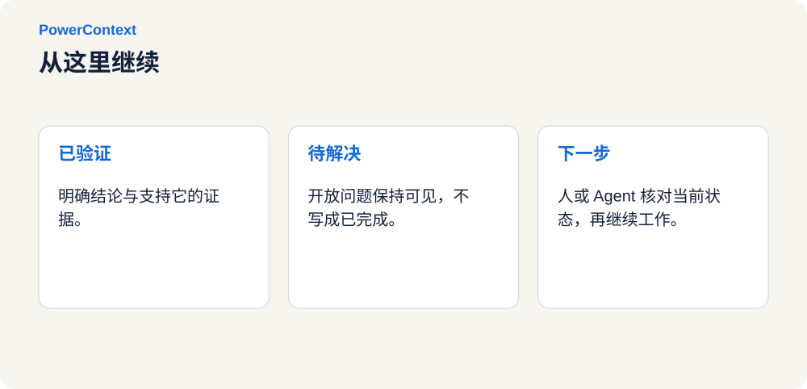](../../../assets/blog/powercontext-1-0-0-release/figure-16.zh.svg "查看大图")

PowerContext 开源仓库：https://github.com/oceanbase/powercontext

在这里，也想认真感谢每一位参与 PowerMem 与 PowerContext 建设的开源贡献者。代码实现、Agent 集成、测试与评测、文档完善，以及 Issue 里的问题复现和设计讨论，都是这个项目向前推进的每一步。也感谢愿意把他用进真实工作的用户。

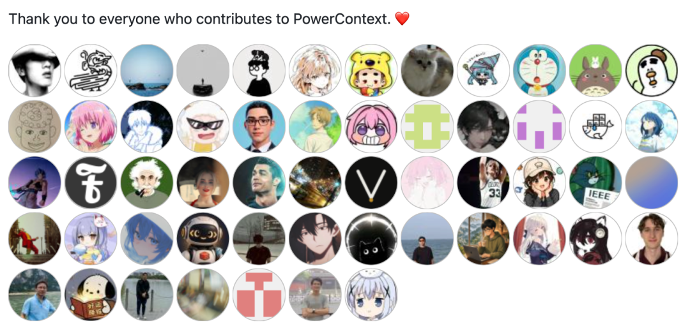

*原始贡献者合影，保留原图中的英文致谢。*

## 未来最稀缺的，不是更会回答的 Agent，而是不会让工作丢失的系统

### 未来规划

接下来，我们计划沿着三个方向继续推进：

* 提升效果：完善采集、检索、使用过程的可观测性，持续跟踪质量、耗时和成本。
* 增强易用性：改进交接与恢复体验，深化宿主集成，完善共享、权限、审计和运维能力。
* 加强可靠性：加强冲突与过期处理，让任务结果和用户反馈进入可验证、可审核的 Experience 与 Skill 演进流程。

这些方向还需要真实工作来检验。一个能复现的失败案例、一份暴露遗漏的交接单，都会帮助我们看清哪里还没做好。

### 总结

一项工作跨过会话、模型和参与者时，需要带上已经验证的判断、仍未解决的问题，以及各自的证据。

**PowerContext 保存这条来路，也把未完成的部分整理给下一位。**

会话结束时，下一位接手者不必再从“先介绍一下项目背景”开始。他应该先看到当前目标、走过的路、仍需核实的地方，以及证据在哪里，然后从那里继续。

[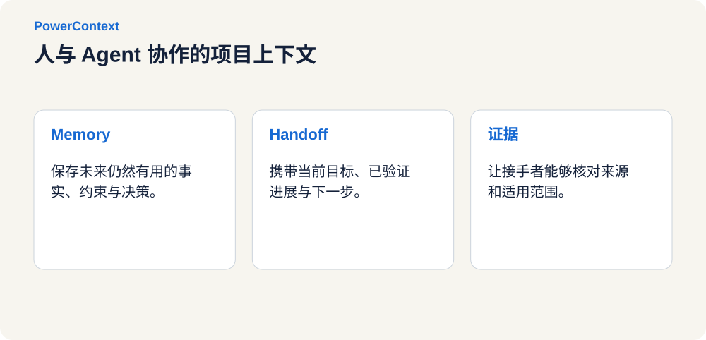](../../../assets/blog/powercontext-1-0-0-release/figure-18.zh.svg "查看大图")


## 参考资料

[^1]: [阿尔弗雷德·丁尼生，《尤利西斯》](https://www.poetryfoundation.org/poems/45392/ulysses)

[^2]: [组织背景成为 Agent 能力的一部分](https://openai.com/zh-Hans-CN/index/inside-our-in-house-data-agent/)

[^3]: [带状态的 Agent 运行环境](https://openai.com/index/introducing-the-stateful-runtime-environment-for-agents-in-amazon-bedrock/)

[^4]: [持续科研工作](https://www.anthropic.com/research/long-running-Claude)

[^5]: [Symphony](https://openai.com/index/open-source-codex-orchestration-symphony/)

[^6]: [Context Hub](https://www.langchain.com/blog/introducing-context-hub)

[^7]: [生产级 Agent 指南](https://cloud.google.com/blog/topics/developers-practitioners/five-guides-to-building-and-scaling-production-ready-ai-agents)

[^8]: [Build 2026](https://blogs.microsoft.com/blog/2026/06/02/microsoft-build-2026-be-yourself-at-work/)

[^9]: [多 Agent 协作实验](https://www.anthropic.com/research/multiagent-systems)

[^10]: [可信 Agent 的实践](https://www.anthropic.com/research/trustworthy-agents)

[^11]: [Agent 接入指南](https://powercontext.oceanbase.io/zh/docs/tutorials/agent-quickstart/)
