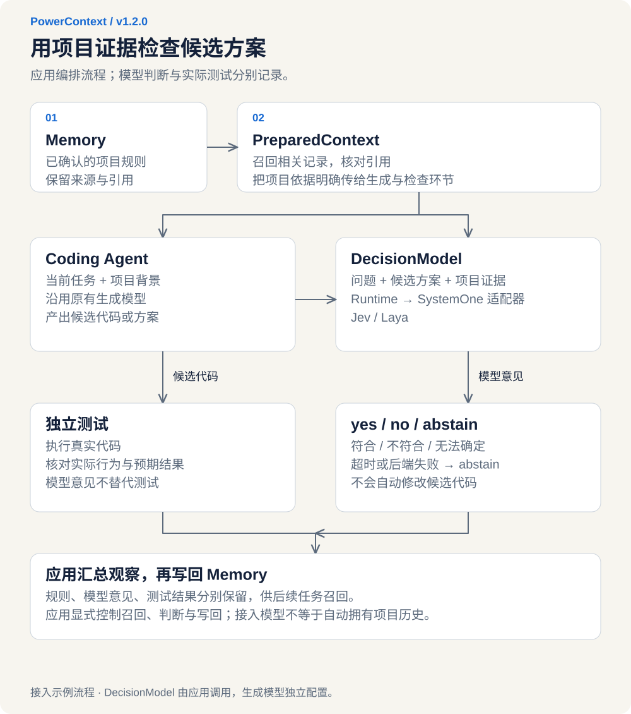
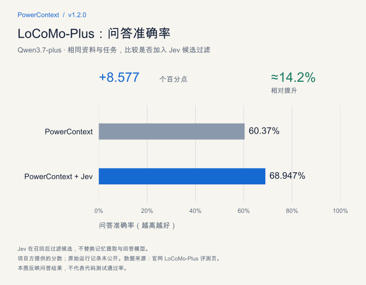
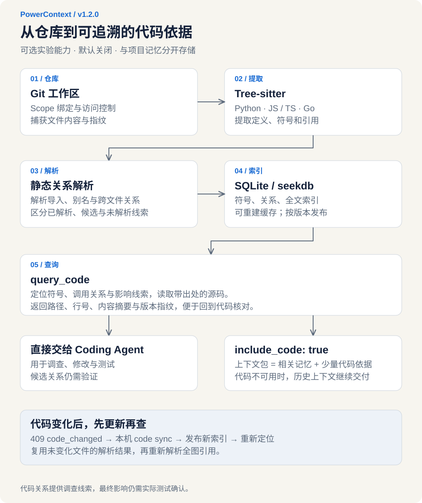
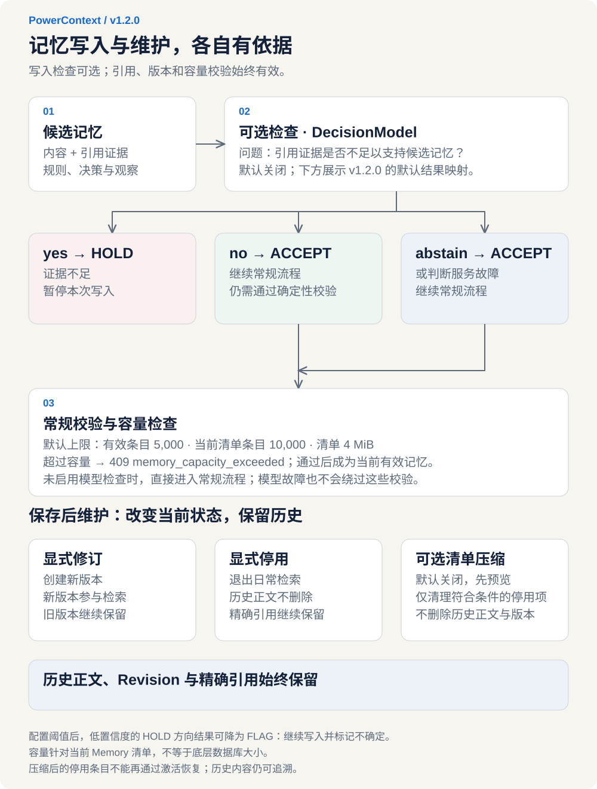

让 Coding Agent 写一段金额处理程序，任务听起来很简单。但真正放进真实的项目里，要考虑的事情就多了：不足一分钱的尾数怎么取整，退款是否用同一套规则，旧客户依赖的行为能不能改。

这些细节，团队可能早就讨论过，刚接到任务的 Agent 却不知道。即使把规则说明白了，改代码时还有另一个问题：这段逻辑在哪里，哪些地方正在用它？看着只改了一个函数，影响可能出现在订单页面、账单导出或售后流程里，Coding Agent 需要通过各种 head、cat、grep 等组合命令去寻找关联代码，不仅效率低下，还很消耗 Token。

OceanBase PowerContext v1.2.0 今天发布！

重点就是让 Coding Agent 做项目时更丝滑的用上这两类依据。已有的项目记忆可以交给决策模型，用来检查方案是否符合约定；新版本新增的原生代码理解能力，则帮助 Coding Agent 调查当前仓库，在动手前找到相关实现和调用位置。

## 一、项目经验先留得住，判断和改代码才有依据

还是以上面的例子为例：先看团队已经定下的规则。

比如，上周处理退款时，大家确认了金额应该如何取整，也排除了一种不适合当前项目的处理方式。如果这些结论只留在那次讨论里，下一个任务开始时，还得再解释一遍。

PowerContext 已有的记忆能力，就是把这些结论连同依据留下来。

旧版本为什么还要支持，看似简单的修改为什么一直没做，某个方案为什么被放弃，都可以保存成项目记录。

新任务开始时，应用或配好召回的 AI 工具，可以根据当前问题，从选定项目中找出相关记录，整理成这次任务可用的上下文。开发者也可以直接让 AI 去查。需要核对时，还能沿着来源和历史版本查看依据，判断过去的结论是否仍然适用。

这也是上下文工程要解决的一部分问题：挑出当前任务需要的信息，把后续还会用到的内容留下来。Anthropic 在介绍上下文工程时，也强调了相关信息的选择和长期笔记的作用。（可查看链接：https://www.anthropic.com/engineering/effective-context-engineering-for-ai-agents）

有了这些记录，接下来的问题才有了着落：怎样让模型按照项目自己的规则检查方案？

## 二、决策模型如何接入？

“这份实现符合金额处理规则吗？”这类问题不需要模型再写一篇方案，需要的是针对明确问题给出判断。

把问题和答案范围事先定好，再提供判断所需的材料，正是决策模型的用法。

* TypeSafe 的 Jev 在 2026 年 9 月 15 日进入早期访问，针对具体问题给出选择、评分或判断。LangChain 也介绍了怎样把它用于 AI 评估和具体任务。

  Jev 发布说明（可查看链接：https://typesafe.ai/blog/introducing-system-one-models-and-jev）

  LangChain 应用介绍（可查看链接：https://www.langchain.com/blog/building-prod-with-jev-and-langgraph）

* 两周后的 9 月 29 日，OpenAI 在 DevDay 上发布了 Decisions API，同样面向这类限定答案的判断。它使用 Luna，开发者可以定义一组问题及各自有限的预定答案，提供文本或图像作为上下文，再用结果分类内容、路由请求或选择智能体的下一步。

  DevDay 2026 回顾（可查看链接：https://openai.com/zh-Hans-CN/index/devday-2026-recap/）

模型能做判断，项目里的规则仍然需要我们交给它。

PowerContext v1.2.0 提供了 DecisionModel 接口，把问题、待判断的内容和项目证据放进同一次请求。

目前已有 Jev 和 Laya 的接入示例，接入逻辑详情见图：（点击配图可查看大图）

[](../../../assets/blog/powercontext-1-2-0-jev/decision-flow.zh.svg "查看大图")

### 举个例子：一分钱背后的团队规则

回到金额处理这个任务。

团队已经确认了取整方式、退款规则和非法金额的处理方式，通用写法未必满足这些要求。

* PowerContext 的示例先把规则保存为项目记忆，再在准备上下文时找出相关记录；

* Coding Agent 据此写方案，决策模型也拿到这些记录，按同一套规则检查方案。接上模型并不代表它自动拥有项目历史，相关证据需要明确传入。

* 决策模型给出的意见，也要和程序的实际表现分别看。

示例会让同一个 Coding Agent 做两次任务：一次只收到当前要求，另一次还拿到项目已有的规则。两份方案交给 Jev 或 Laya 检查，再由独立测试核对程序运行后的结果。

这样，历史约定有没有传到模型面前、模型的判断是否符合要求、程序实际有没有做对，都有各自的记录可查。

模型意见和测试结果会分别保留，任务结束后，示例还会把观察到的情况写回项目记忆。下次遇到类似问题，团队就能查到当时用了什么规则、检查过哪些情况、得到了什么结果。

### 原来的 Coding Agent 不用换

接入可以从方案生成后的一个检查点开始，原来写代码的模型继续用。

应用负责选择项目背景、安排流程，再通过 DecisionModel 传入问题、待检查的方案和召回的证据，取得 yes、no 或 abstain（目前无法确定）。

这个接口不绑定厂商，也不出现在 Coding Agent 的工具列表里，由应用在需要判断时调用。

下面这段代码展示了 PowerContext 接入 Jev 后，如何取出一条已保存的规则，与候选代码一起交给模型判断：

```python
# 1. 配置 Jev 服务，凭据从环境变量读取。
provider = SystemOneConfig(
    provider="jev",
    endpoint=os.environ["JEV_ENDPOINT"],
    model=os.environ["JEV_MODEL"],
    api_key=SecretStr(os.environ["JEV_API_KEY"]),
)
backend = SystemOneDecisionModel(provider, client)

# 2. 把适配器交给 PowerContext。
async with open_builtin_runtime(
    config,
    decision_model=backend,
    scheduler_path=directory / "scheduler.db",
) as runtime:
    memory = runtime.memory.for_scope(scope.scope_id)
    record = await memory.get(
        GetMemoryEntryRequest(citation=saved.entry.citation)
    )

    # 3. 问题、候选代码、项目规则，一起进入判断请求。
    result = await runtime.decision_model.evaluate(
        DecisionRequest(
            decision_kind="example.invoice-review",
            question="这份实现是否满足证据中的所有金额转换规则？",
            subject="def cents(text):\n    return round(float(text) * 100)",
            evidence=(record.entry.text,),
        )
    )
    print(result.outcome.value, result.used_fallback)
```

Jev 和 Laya 的请求格式由各自的适配器处理，调用方使用同一个 PowerContext DecisionModel 接口。

希望把决策模型部署在自己环境中的团队，可以接入 Laya，再用实际任务比较效果。更换决策模型时，调整对应的适配器，已有的 Coding Agent、项目记忆和后续测试都可以沿用。

如果判断服务暂时调不通，这一步返回 abstain，方案和测试不会因此停住。对于“目前无法确定”的结果，团队可以补充依据或另行检查。PowerContext 提供了可运行的示例，决策模型通过适配器接到 DecisionModel 上。

## 三、接上决策模型之后，多出来的判断有没有用

上面的例子展示了决策模型通过几行代码即可轻松接入 PowerContext 的运行时，在上下文环节起决策作用。那实际效果如何呢？

我们在版本发布前特意做了 LoCoMo-Plus 压测来探知效果。

PowerContext 原有流程已经会查找相关记录。这组对照使用相同的资料和任务，在原有流程上加入 Jev，让它参与上下文选择，判断哪些内容更有助于回答当前问题，并观察最终回答和运行开销的变化。图中的「PowerContext + Jev」，指的就是多了这一步判断。

[](../../../assets/blog/powercontext-1-2-0-jev/benchmark.zh.svg "查看大图")

图中展示的是 Qwen3.7-plus 的问答评测结果。加入 Jev 后，回答准确率从 60.37% 提高到 68.947%，相对提升约 14.2%。这组数字对应的是历史资料选择对问答结果的帮助；前面金额处理示例中的代码是否正确，仍由独立测试核对。

## 四、原生代码理解：让 Coding Agent 看懂仓库

再回到金额处理任务。

即使规则已经清楚，修改仓库里的现有实现时，Coding Agent 还得找到相关代码，弄清哪些地方在用它。项目记忆能解释过去为什么这么定，当前实现和调用关系则需要回到仓库里调查。

比如调整退款金额的计算方式，订单页面、账单导出和售后流程可能都在使用这段逻辑。动手之前，先查清这些联系，才知道接下来该检查哪些地方。

PowerContext v1.2.0 的原生代码理解提供的就是这类调查能力。实现原理如下图所示：

[](../../../assets/blog/powercontext-1-2-0-jev/code-understanding.zh.svg "查看大图")

### 改之前，先看到联系

收到任务后，Coding Agent 可以找到相关代码，查看与它有关联的部分，读取具体内容，再据此继续调查。修改公共逻辑前，先查谁在用它；检查变更时，重点看可能受影响的部分。查询结果会保留具体出处。开发者可以回到代码里核对 Agent 的建议，另一位同事或其他工具接手，也能沿着这些线索继续查。

启用这项能力后，PowerContext 原有的上下文包中，可以同时放入相关项目经验和少量当前代码依据。

比如，历史记录写着“旧客户仍在依赖这项功能，暂时不能改变它的行为”，代码调查则帮助 Agent 找到对应的实现和使用位置。团队的约定有了具体的代码可对照，修改的边界也就更容易说清楚。

### 代码更新了，认识也需要更新

仓库还在变化，上次查到的关系不能一直照用。PowerContext 会在查询时检查代码是否发生变化；发现原有分析已过期，就要求先更新，再继续使用。

历史记录和当前代码分析分开保存，也是为了便于核对：一年前的做法可以参考，今天是否适用，还要看现在的实现。

原生代码理解目前是可选的实验能力，提供调查线索和可查的依据，改动的最终影响仍需结合实际测试确认。可以先在一次具体修改中启用，看看 Coding Agent 是否能更快找到需要检查的位置。

## 五、记忆治理：让交出去的经验仍然可用

从找回规则、检查方案，到调查代码，项目里留下的依据都在被反复使用。任务结束后，团队也可以把新的观察保存下来。

记录越积越多，就得继续维护：哪些结论还有效，哪些已经过时，哪些只是当时的猜测？“这个方案应该能解决问题”和“这个方案在这些条件下通过了验证”，对后来接手的人来说，用处很不一样。保存时把条件和依据一起记下，下次才有东西可核对。

PowerContext v1.2.0 增加了保存前的可选记忆质量检查的能力，处理逻辑详见下图：

[](../../../assets/blog/powercontext-1-2-0-jev/memory-governance.zh.svg "查看大图")

同样通过 DecisionModel 调用。

它检查的是现有引用能否支持这条记忆：如果不能，就先暂停写入，或者标成待核对；如果返回 abstain，或判断服务不可用，写入仍会继续，避免模型故障卡住记录的保存。这类检查提供辅助判断，内容仍要根据实际结果维护。

已经存下来的记录也可以调整。

PowerContext 原有的记忆管理支持修订，让过时记录退出日常检索，同时保留历史。团队改了约定，后续工作就用更新后的内容，需要时仍能回看当初的选择。记录多了，还可以管理当前使用的记忆规模，整理符合条件的失效记录。值得复用的做法，则可以记下当时的情况、采取的行动和实际结果，整理成经验，审核后供后续查阅。比较稳定的操作方法，也可以进一步整理成技能指引，经审核并导出到支持的工具后使用。

这样，一次任务留下的内容，才有机会在后面的工作中派上用场。

## 六、接进每天使用的工具

这些能力要进入日常工作，还得接进开发者已经在用的工具。

PowerContext 已支持接入 Codex、Claude Code 等 AI 工具，可以在相应环境中查阅背景、保存记忆和交接工作。

这次还扩展了 ZCode 的社区集成，覆盖命令行和 Windows 桌面。

比如，退款逻辑查到一半，要从终端转到桌面客户端继续，就可以事先准备交接材料，把目标、已确认的事实、遇到的阻碍和下一步留下来。接手的 Coding Agent 先看已有结论，再核对当前情况，不必把查过的部分从头再查一遍。换人或换会话时，也可以用这种方式接续工作。

一句话接入：

```text
帮我安装并使用 powercontext, 项目地址：https://github.com/oceanbase/powercontext
```

## 七、结尾：从一个检查点和一次改动开始

想试试这次更新，可以先选一个手头的任务。

如果项目里有已经确认的业务规则，就在方案生成后增加一次检查，把规则和方案交给 Jev 或 Laya。原来的 Coding Agent 继续写代码，再看模型有没有按约定判断、程序实际跑出来对不对。

如果准备修改一段被多处使用的代码，就启用原生代码理解，让 Coding Agent 先查相关实现和调用位置。顺着它给出的出处核对一遍，再动手修改和测试。下次再遇到金额处理这样的任务，团队定过的规则能成为模型的判断依据，仓库里的调用关系也有出处可查。

**PowerContext · 不止记忆，更是完整的项目历程。**

项目链接：https://github.com/oceanbase/powercontext
